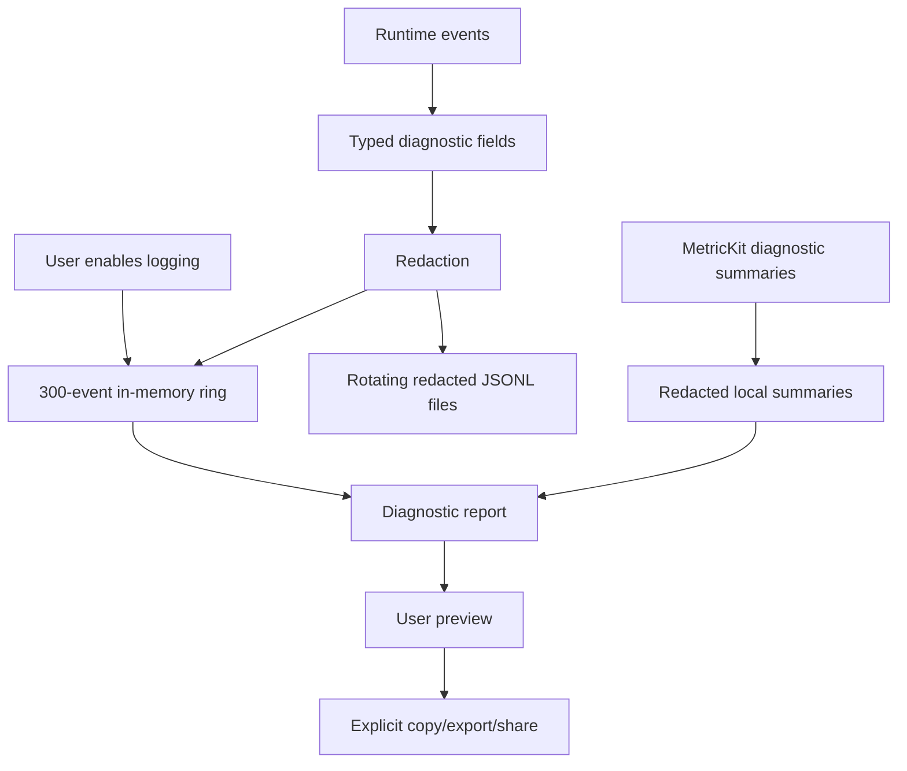

# Diagnostics and privacy

Labstream diagnostics are for user-initiated debugging, not analytics. See [Report a bug](REPORTING-BUGS.md)
for the user-facing copy/export workflow; this page defines the technical privacy contract.

## Contract

- Diagnostic event logging is off by default.
- Events stay local in a 300-event process ring and, while logging is enabled, one
  approximately 1 MB JSONL file plus up to three rotated archives. The same redacted event summary
  is also emitted to Apple's local unified log. The disk copy is already redacted and exists for
  user-initiated headset evidence after suspension or termination.
- Reports are copied, exported, or shared only after a user action.
- The app does not upload diagnostic reports automatically. An explicit feedback/share action may
  hand the report to GitHub or another destination selected by the user.
- Reports must omit or redact tokens, client identifiers, hostnames/IP addresses, full URLs, usernames, library paths, filenames, and media titles.
- Free-form user notes are best-effort scrubbed, but users should still review the preview before posting publicly.
- Known redactor residuals that the preview review must catch: media titles written as plain prose
  (no file extension), dotless personal or device names (for example "Bob's Laptop"), bare or
  zone-scoped IPv6 literals (for example `2001:db8::1` or `fe80::1%en0`), and credentials under
  non-standard keys such as `pw=` or `pass=`. `DiagnosticLoggingTests` pins these as documented
  residuals.

## Typed fields

Use `DiagnosticFieldValue` constructors instead of raw strings:

- `.label` for safe categorical labels;
- `.text` only for intentionally safe text;
- `.urlShape` for scheme/path-shape reporting without hosts/tokens;
- `.identifier` for stable-but-redacted identifiers;
- `.error`, `.bytes`, and bucket helpers for safe summaries.

The redaction layer runs when fields are constructed and when reports are rendered. Do not add raw URLs, tokens, server names, usernames, paths, filenames, or media titles to diagnostic fields.

## Report contents

A report may include:

- app version/build and OS/device class;
- active backend;
- server product/version where safe;
- connection scheme, not host;
- selected quality settings;
- Adaptive Bitrate state;
- exact download counts and queue state, plus bucketed storage totals and conservative
  orphan-candidate counts;
- recent playback snapshot;
- passive redacted MetricKit crash/hang/CPU/disk-write diagnostic summaries;
- up to 80 recent redacted events from the current process ring.

Download fields are absent on tvOS, which does not compile the Downloads capability. MetricKit
summaries are unavailable on tvOS and are collected independently of the opt-in event-logging
toggle on other platforms.

The in-app report does not reload the rotating JSONL files. Those files are collected only by the
repository's explicit evidence tooling, and still require the user to review anything before sharing it.

The Mac target uses the same typed/redacted report pipeline and may add safe platform,
effective bundle-identity, sandbox-storage, download, and playback facts. Per-worktree bundle IDs
and container paths must not be emitted as raw identifiers or filesystem paths.

## Download recovery evidence

Download diagnostics distinguish a drained background wake, timeout and startup-blocked release;
`downloads.background_wake_terminal` records the bounded outcome and handler count. Timeout is
not a durability success. Exact-attempt persistence failures, refused finalization, condemnation,
cleanup deferral and hidden/pending artifact audit counts explain recovery without exposing raw
paths or handles. Storage audits are report-only and count hidden working, held and temporary
files as well as published bytes. Keep IDs redacted and byte/count fields typed.

The build-1506 field report motivates bounded recovery and asynchronous persistence, but an app
ring buffer without a termination signature cannot identify watchdog, jetsam or crash cause. The
matching `.ips`/JetsamEvent remains required; unit/hosted evidence does not replace it.

## Public issue reminder

GitHub issues are public. The app and docs ask users to review diagnostic reports, personal labels,
screenshots, videos, and logs before submitting because automated redaction
cannot understand every personal detail in free-form prose or images.
