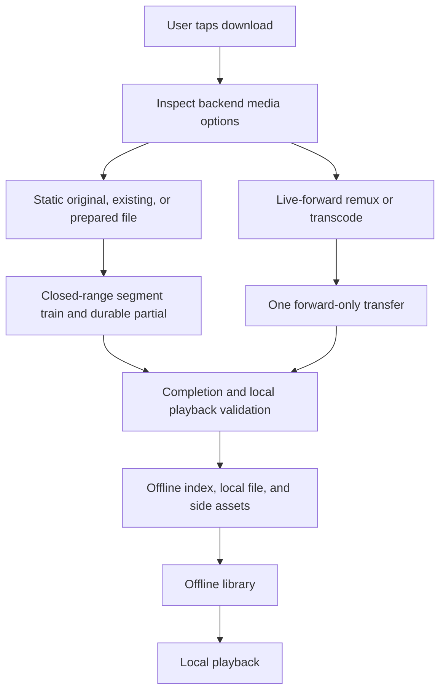
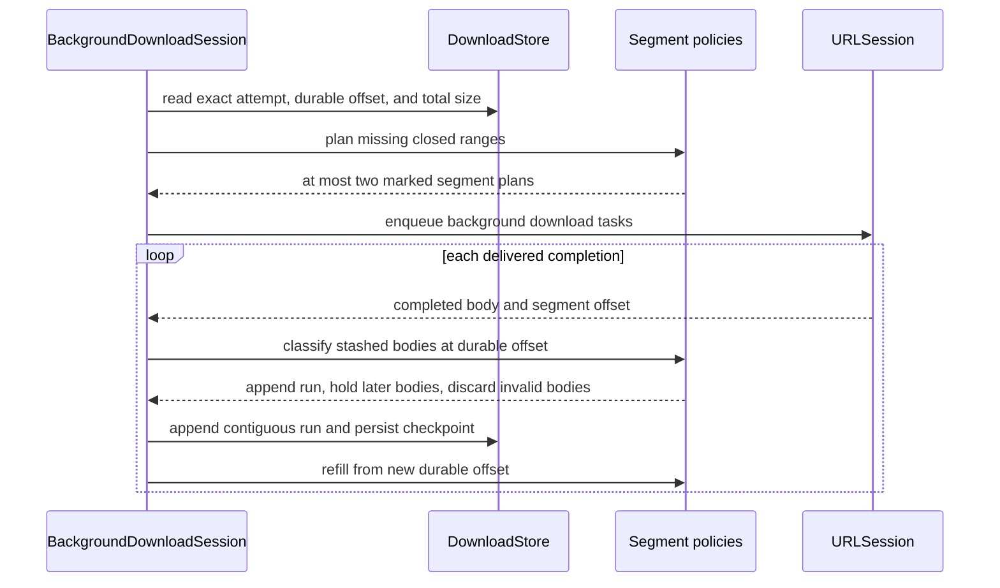

# Downloads and offline playback

Labstream downloads are implemented for the visionOS, iOS/iPadOS, and macOS targets and are designed
to end in a local file the current device can play, plus enough metadata to show the item in the
offline library and resume safely. The same engine is present in the [macOS target](MACOS.md), where
background recovery remains a pre-release acceptance gate rather than a reliability promise. The
[tvOS target](TVOS.md) compiles no Downloads capability or Offline surface.

## Core rules

- A completed download must have a local playable file and a durable offline record.
- Direct original downloads are offered only when Labstream expects the file to play locally.
- Server-rendered or server-prepared routes are used when the original is not a safe local target.
- Transfers reconcile on relaunch. Static/original and server-prepared static routes
  resume from durable checkpoints when their persisted authority remains valid; live-forward
  remux/transcode streams may become retryable and restart from the beginning
  rather than claiming unsafe byte-offset resume.
- Offline records must never contain access tokens. They do persist the minimum backend
  context needed to resume and clean up a job, which currently includes the owning backend,
  server base URL/server ID, MediaBrowser user ID where applicable, media/play-session IDs,
  and route/checkpoint state. See [Persistence](PERSISTENCE.md#app-container) for the complete
  on-disk and credential boundary. Treat `index.json` as private app data, not a shareable profile.

## Backend routes

| Backend | Download choices |
| --- | --- |
| Plex | Compatible original, explicit existing version, and completed optimizer output all hand off to a static file transfer. |
| Jellyfin | Original is static/range-resumable. Compatible remux and capped transcode are live forward-only streams. |
| Emby | Original, reusable existing version, and completed Convert output are static. Compatible remux is live forward-only; a requested transcode is normally rerouted through persistent Convert-then-static. |

## Transfer lifecycle

Each download row persists a **lifecycle** and an **attempt history**. Every change to them goes
through one pure reducer, `DownloadLifecycleReducer`. The serialized `DownloadStatus` that the
UI, diagnostics and older app versions read is derived from the lifecycle.

```mermaid
stateDiagram-v2
  accTitle: Download lifecycle
  accDescr: A row is planned or admitted, may prepare on the server, transfers bytes, and enters finalizing once a complete body exists. Finalizing ends complete or unverified after publication, or failed. Interruptions pause a row with a recorded cause; errors fail it with a recorded reason. Retry modes choose where a paused or failed row resumes.
  state "planned" as Planned
  state "admitted" as Admitted
  state "serverPrep" as ServerPrep
  state "transferring" as Transferring
  state "finalizing" as Finalizing
  state "paused" as Paused
  state "failed" as Failed
  state "complete" as Complete
  state "unverified" as Unverified
  [*] --> Planned
  [*] --> Admitted
  Planned --> Admitted: admission granted
  Admitted --> ServerPrep: Plex optimize or Emby Convert
  ServerPrep --> Admitted: prepared source handed off
  Admitted --> Transferring: transfer starts
  Transferring --> Finalizing: complete body at the working path
  Finalizing --> Complete: validated and published
  Finalizing --> Unverified: published; probe inconclusive or repeated truncation
  Finalizing --> Failed: validation fails
  Transferring --> Paused: interruption (cause recorded)
  Transferring --> Failed: transfer fails (reason recorded)
  Paused --> Admitted: resume or retry
  Paused --> Transferring: resume blob
  Paused --> ServerPrep: prep reattach or Convert resume
  Failed --> Admitted: retry
  Unverified --> Complete: local playback or revalidation
  Complete --> [*]
  Unverified --> [*]
```

| Lifecycle | Serialized status |
| --- | --- |
| `planned`, `admitted` | `queued` (a `planned` row is waiting for an admission lane) |
| `serverPrep` | `preparing` for Emby Convert; Plex optimizer rows stay `admitted`/`queued` until the handoff |
| `transferring`, `finalizing` | `downloading` |
| `complete`, `unverified`, `paused`, `failed` | the same name |

**Attempt history** records what no status can:
- truncation strikes;
- the reason a row is `unverified`;
- the last failure;
- why a row paused (user, queue paused, system interruption, awaiting a session, storage,
  deferred resume).

Rules that follow from this:

- **Progress never promotes a paused, failed or finalizing row.** It only records the bytes
  (B09).
- **`finalizing` is persisted** as soon as a complete body reaches the attempt working path. A
  relaunch before validation re-finalizes that body instead of deleting it (B10). A forward-only
  body exists at the working path only once its whole transfer finished, so the same rule covers
  a finished forward-only body whose task was lost.
- **Truncation strikes persist** with the row and survive a relaunch.
  - A Retry of the same server, account, item, source and profile inherits them, and a replayed
    validation outcome is not counted twice.
  - The second strike keeps the body as `unverified` and publishes it.
  - Revalidating a published body never fails or deletes it for truncation (B54).
- **Relaunch reconciliation** applies the reducer to each row's facts: route, durable checkpoint,
  body, pending artifact intents, deletion state and live task. Any file deletion it decides runs
  outside the store lock.

Finalization still rewrites HEVC `hev1` to `hvc1` before validation, and both terminal success
states keep the local file. The opaque and static-range pipelines share the completion path.

## Background downloads and sleeping devices

Downloading while the app is backgrounded, suspended, or the device is locked/asleep is
fundamentally constrained by the platform, not by the server or the app:

- **Only system-owned transfers keep running.** True background `URLSessionDownloadTask`s owned
  by the system daemon (`nsurlsessiond`) may continue; app-side work (server-prep polling,
  keepalives, timers) is frozen while the app is suspended.
- **Background transfers are deprioritized.** The OS gives interactive networking and power
  management priority over background bulk transfers, so throughput can be substantially slower
  than the same download with the app active.
- **Background app wake-ups are rate-limited.** Each time the system relaunches the app for a
  background-session event, it may delay the next opportunity to do app work. Any design that
  needs an app wake-up per bounded transfer therefore stalls after a handful of handoffs
  regardless of transfer size.
- **Background scheduling remains system-controlled.** Labstream asks for non-discretionary
  transfers, but the OS still decides when background work runs and how much network/power budget
  it receives.

Labstream's static byte-range lane is shaped around these limits and follows the simplest
Apple-standard architecture we can make stable:

- **A pre-queued train of closed-range segment tasks for known-size static files.** The
  same segment-train engine runs on visionOS, iOS/iPadOS, and macOS; Mac background recovery
  remains a platform-specific release-acceptance gate.
  Static Plex/Jellyfin/Emby file routes enqueue up to `maxQueuedSegments` (currently 2) background
  `URLSessionDownloadTask`s ahead of the durable checkpoint, each a closed
  `Range: bytes=<offset>-<offset+segmentBytes-1>` request of `segmentBytes` (512 MiB) —
  roughly 1 GiB of queued runway per file. The two-task cap is intentional: one head plus
  one look-ahead preserves overlap without multiplying several visible downloads into
  dozens of concurrent transfers. `StaticRangeSegmentQueuePolicy` is the pure
  planner: given the durable offset, the expected total size, and the segment offsets
  already live in the session, it emits the closed ranges still needed, up to the queue
  depth. When the expected total size is unknown, the planner falls back to a single
  open-ended `Range: bytes=<durableOffset>-` plan — the same shape used before segmentation,
  so that fallback is a zero-regression path rather than a special case.
  `StaticRangeTransferConfiguration` owns only the segment size and queue-depth constants;
  transfer shape remains planner-owned so the unknown-total open-ended fallback follows the
  same attempt and durable-checkpoint rules as the closed train.
- **Segments are attempt-marked and stashed, then assembled in order.** Each new segment
  task's `taskDescription` combines the rating key and current
  `lbs-segment:v3:<offset>:<attemptID>` marker with a U+001F separator. Relaunch/reattach
  therefore requires both the row and exact attempt, not merely a reused rating key.
  Old V1/V2 segment markers, V1 opaque markers, bare descriptions, and URL-derived identity are
  no longer parsed or adopted. `StaticRangeReattachPolicy` accepts only a current,
  offset-matching task for the row's exact attempt; every unmarked, malformed, stale-attempt, or
  mismatched task is cancelled.
  When a segment task
  finishes, its body is stashed by offset; `StaticRangeSegmentAssemblyPolicy` — a pure
  assembler — decides, given the durable offset and the set of stashed finished bodies,
  which stashes form the maximal contiguous run starting exactly at the durable offset
  (appended now), which are held (a later segment finished out of order, waiting on a gap),
  and which are discarded (fully behind the checkpoint, or overlapping but not
  offset-aligned — the same non-negotiable append-alignment invariant as the pre-segment
  design). Appending a run advances the durable checkpoint and refills the train back up
  to the queue depth.
- **URLSession resume data remains first-class only for the single open-ended fallback.**
  The store has one resume-blob slot per download row. When an unknown-size static source uses
  `Range: bytes=<durableOffset>-`, pausing can preserve that task's OS temp progress and display
  watermark in a blob. Adoption requires the blob's original open-ended Range offset to equal the
  current durable partial.
- **Closed train segments never persist or adopt URLSession resume data, including the head.**
  CFNetwork can replay a resumed closed request past its original end, so pausing a segment train
  clears any old blob/watermark and plain-cancels unfinished segments. The app-owned durable partial
  remains authoritative. Completed held bodies are durably manifested and may be rehydrated across
  relaunch only when their exact attempt, length, and validator checks still match; mismatches fail
  closed and re-fetch. Unfinished ranges are planned again on Resume.
- **The durable partial is the fallback.** A rejected old-format closed-range blob, or an open-ended blob that is
  missing, malformed, stale, exhausted, or backed by a deleted temp file, is rejected and cleared
  together with its display watermark. Recovery then re-plans from the durable partial's current
  file size rather than appending unvalidated bytes.
- **HTTP safety checks still guard the append.** Completed bodies are validated for
  `Content-Range` start alignment, pinned validator mismatches, HTTP `200` full-body
  replacement/restart behavior, `416` total validation, temp disappearance fallback, and safe
  resume-blob adoption/clearing. A strangely resumed transfer is rejected, restarted, or
  falls back to the durable partial rather than appending unvalidated bytes.
- **Why segments, not one task:** a visionOS wake bounce can silently restart the body of an
  in-flight custom-`Range` request with no error and no resume-data callback (see the
  [verified platform finding](DEVELOPMENT.md#verified-platform-findings)). With one open-ended task, that restart forfeits
  every un-appended byte transferred off-head, unbounded overnight. With a segment train,
  nsurlsessiond executes pre-queued segments with the process dead — no per-continuation app
  wake is required — and a wake-time bounce can only restart the one segment that was mid-flight
  (at most `segmentBytes`). Markers allow surviving tasks and delivered completions to be
  mapped back to their row and offset after reattach, but do not assume the OS will always
  redeliver a completion that occurred while the process was dead. Only bodies actually
  recovered through the background-session lifecycle are adopted; otherwise the durable
  partial remains authoritative and the missing range is re-planned and re-fetched.

Simulator caveat: Labstream intentionally uses a foreground/default `URLSession`
in simulator builds because the background transfer daemon is unreliable there.
Simulator passes can validate routing, progress UI, and retry policy, but not
real background continuation, lock/off-head scheduling, or cellular policy.

User-facing expectations worth setting (the "downloads disclaimer"):

- Very large background downloads are best-effort. Keeping the device on power helps; briefly
  foregrounding the app gives Labstream a chance to process delivered completions or recover
  app-owned work, without guaranteeing any change to the OS scheduler.
- Plex optimize and Emby Convert are server-side preparation jobs. Their app-side polling and
  handoff cannot run while the app is suspended; Emby Convert job identity is persisted so polling
  can resume after relaunch. Once either route hands off to a static file, the byte transfer can use
  the static recovery path.
- Fresh and resumed Plex optimize jobs inspect metadata before creating work. They reuse an
  existing render only when it is a server-optimized part (under
  Plex's "Plex Versions" path) that matches the requested tier: resolution as a bounding box
  within ±16 px and container bitrate within ×1.10 of the video cap plus 768 kbps, and
  original-quality requests must land at the source height. `OptimizedVersionMatch` owns this
  rule, so a 1080p/8 Mbps retry never silently reuses an older 720p render.
- Plex queue inspection distinguishes a present item, proven absence, and unavailable inspection.
  Only proven absence plus a successful metadata inspection can create a job. Immediately before
  dispatch, the row durably records a 3-minute visibility grace. Relaunch preserves that timestamp:
  absence during the grace keeps inspecting without another create; proven absence after it fails
  server preparation if no matching version is visible. An HTTP 400 duplicate rechecks adoption;
  other create errors fail promptly. The separate 120-second completion/indexing grace, 24-hour
  prep deadline and authentication failure budget remain in force. Static handoff uses the live
  server lane on which the rendered Part was observed.
- Fresh Plex and Emby preparation starts return after registering their poller tasks. Delete
  cancels those tasks. Emby reuse and completed conversions share one handoff that detaches its
  own poller before releasing prep bookkeeping, then starts the existing-version static lane.
  Pause All leaves Emby Convert polling active and parks the static handoff.
- Jellyfin optimized/compatible-remux downloads, and Emby compatible-remux
  downloads, can be live-forward encoder streams. They may continue as
  system-owned transfers while the OS allows it, but they are not durable
  byte-range checkpoints and can require retry/restart after interruption.
- Cellular downloads are off by default where cellular data is available.
  Settings ▸ Downloads ▸ **Use cellular data for downloads** also governs
  constrained networks (Low Data Mode) and expensive networks such as a personal
  hotspot: while it is off, downloads wait for an unconstrained, inexpensive
  network. It applies to newly created request-based transfer tasks and side-asset
  fetches; active tasks and tasks resumed from OS resume data keep the policy
  they were created with.

## Module ownership

| Component | Owns |
| --- | --- |
| `DownloadManager` | Main-actor queue coordination and user-visible state. |
| `DownloadKeepaliveCoordinator` | Exact-attempt Jellyfin/Emby keepalive task ownership and credential-generation quarantine. A keepalive runs only while the session tracks a live transfer for that attempt. Emby sends Ping only; Jellyfin currently sends Playing/Progress at a fixed position of 0 instead of the transfer's byte fraction. This is an interim containment: it stops downloads from reporting advancing positions, but it is not proven to leave watch state untouched. The live Ping-only A/B decides the final shape, and the watch-state check stays open until it does. |
| Backend-specific manager extensions | Plex/Jellyfin/Emby route setup and server-prep polling. |
| `BackgroundDownloadSession` | URLSession tasks, segment-train enqueue/refill, transfer callbacks, finalization, and wake-release effects. |
| `BackgroundDownloadWakeCoordinator` | Locked background-completion gate, atomic deferred-revalidation keys, and range-rebuild grace generations. |
| `DownloadManager+SeasonPlanner` and `SeasonDownloadPlannerSheet` | Immutable season drafts, one atomic Store commit of planned rows plus retry intents, and the refreshed, source-validated first start. |
| `DownloadAdmissionCoordinator` and `DownloadManager+Admission` | The one admission window: observed lane occupancy, supervised starts, durable waiting requests, backoff and the Pause All row exemption. |
| `DownloadOptionsModel` | Typed per-item option resolution for the download sheet; it does not own season planning. |
| `DownloadVolumeFreeSpace` | Purgeable-inclusive free-space measurement used by storage-full parking. |
| `DownloadStore` | Schema-v5 index state (v4 loads and is upgraded once), exact-attempt mutation admission, work admission (`attemptAdmitsWork`), and transactional artifact state. |
| `DownloadArtifactLifecycleCoordinator` and file-effect seams | Order attempt-scoped resume/checkpoint/promotion/deletion work with its terminal persistence outcome. |
| `DownloadWorkRegistry` | Attempt-scoped side-cache and encoder-task ownership. |
| `DownloadCleanupIntentJournal` | Independent durable, credential-free server-cleanup authority for all three backends: Jellyfin/Emby encoders, Emby Convert jobs and Plex optimize queue items. |
| `DownloadCleanupIntentRunner` | The only executor of journaled cleanup: eligibility, ownership recheck, bounded concurrency and per-intent backoff with its own wake-up. |
| `EmbyConvertCleanupJournal` | Legacy Emby Convert tombstones, read only to migrate them into the cleanup journal at launch. |
| PMSKit download policies | Pure route, retry, row-display, and recovery decisions, including the segment-train planner and assembler. |

## Server cleanup

Every server resource a download stops needing is recorded in the cleanup journal before
anything cancels it. That covers a Jellyfin/Emby encoder (`activeEncoding`), an Emby Convert
job (`knownJob`, or `ambiguousCreate` when the create response was lost) and a Plex optimize
queue item (`plexOptimize`). The journal lives in an authority directory outside the versioned
media root. Each write uses the index's commit protocol: temp file, full fsync, rename and
directory sync. A write whose final sync fails is reported as a failure, never proven by
re-reading the file. The directory and every file are excluded from backup and data-protected.

Each intent records why it exists:

| Provenance | Written by | Runs when |
| --- | --- | --- |
| Row deletion | Delete, before the row is removed | the row's removal has committed |
| Terminal release | Launch/backend-switch sweep for a terminal row's handles | the row is terminal and not protecting the job for Retry, or the row is gone |
| Abandonment | Superseded negotiations, stale creates, duplicate jobs, the 24-hour Convert expiry, abandoned Plex seeds, stale optimize-job sweeps | whenever the ownership recheck passes |

The runner executes nothing while a row's deletion is staged, in flight, or failed. Just before
each server call it re-checks ownership: another row's PlaySessionId, Convert job, queue title,
or a job that row's crash-window recovery would adopt keeps the resource. Convert cleanup and
Convert crash-window recovery are serialized per server.

Plex queue responses are classified explicitly:

- a completed render is kept (deleting the queue item would delete the version);
- a malformed list, a duplicate title or an unknown state keeps the intent;
- an absent item retires the intent only once the create PUT is known to have landed.

An unresolved create is retried, slowly after a day, and retired with a diagnostic after a week.
One race is accepted: a render that completes between the queue read and the DELETE is
deleted, because PMS has no conditional cancel. The delete confirmation therefore says
in-progress preparation is cancelled "where possible".

Two fallbacks remain unrecorded. If a superseded-encoder stop or an Emby stale-create cancel
cannot be journaled, it falls back to the earlier best-effort call and records a diagnostic.
Sign-out never journals cleanup: it pauses rows instead.

## Offline metadata

Offline records keep enough information to display and play the item without a live server:

- backend and item identity;
- title/metadata needed for the offline library;
- local file URL and byte counts;
- selected media characteristics;
- optional poster and side-asset references;
- resume/progress state where applicable.

Paths in the JSON index are one-level paths relative to the Downloads directory and are
re-hydrated against the current sandbox at load time. Absolute container paths are not
stable across installs. URLSession resume data is stored as a protected, backup-excluded
sibling artifact and referenced by relative path; it is only valid for static/range-resumable
sources. The storage and backup boundary is detailed in [Persistence](PERSISTENCE.md#app-container).

Side assets such as posters, chapters, and compatible external text subtitles are cached next to the download record when available. They are treated as convenience metadata; the main playable file remains the durable core of the download.

## Reconcile and resume

On launch, Labstream compares the offline index, files on disk, active transfers, persisted
artifact reservations, and durable cleanup intents. Current reconciliation:

Startup first installs all transfer callbacks and registers the still-dormant session with the
background-completion registry. When the Store admits a healthy current index, the initial
transport submission crosses one bounded MainActor turn and retains the manager until that
submission occurs. A retry before that turn cancels the deferred edge and owns the one immediate
submission, so retry cannot overtake it or submit activation twice.

- **Unsupported schemas** keep their explicit reset path.
- **Unreadable indexes and malformed current ownership** remain fail-closed.
- **A v4 index** runs the one-time upgrade pass (see PERSISTENCE) before `.ready` is published.

**Delete** stops exactly its attempt: tracked tasks, any OS task carrying that attempt's marker,
prep pollers and keepalive. It never stops a replacement attempt.

A row being deleted, whether behind a row-deletion barrier or as a capsule, admits no new work:
- transfer start, resume and finalization;
- retry continuation;
- season admission;
- Plex optimize polling and creation. The deferral changes critical-path scheduling only: it does not delete the background
transport, recovery work, persistence barriers, or background-completion durability.

- adopts only current task markers whose exact attempt matches the durable row;
- keeps current malformed/ownerless active rows fail-closed rather than guessing ownership;
- resumes/retries recoverable transfers and surfaces terminal failures in the row. A row whose
  last failure was storage-full is not automatically redriven: every automatic static-range
  redrive (rebuilds, backend-ready drains, launch recovery) first re-measures free space —
  counting iOS purgeable space, matching the Settings storage gauge — and, if the volume still
  cannot hold the remaining bytes plus headroom, parks the row as a pending resume instead of
  retrying. A user-initiated Retry always dispatches regardless of this gate;
- migrates legacy Emby tombstones and pre-upgrade quarantined Plex intents into the cleanup
  journal, then runs required server cleanup through the cleanup runner (see
  [Server cleanup](#server-cleanup));
- inventories and repairs missing posters, subtitles, chapters, Plex/Emby BIF, and Jellyfin
  trick-play playlists/tiles for completed rows without re-downloading playable media. Work runs
  off-main, validates image/BIF/text payloads before promotion, and batches metadata publication.
  Retry authority is exact attempt + source + resource kind and is charged only when an eligible
  waiter actually admits transport; coalesced cancellation or a stale waiter hands authority to the
  next eligible waiter. Playlist repair audits every locally referenced tile. Successful promotion,
  including a same-path replacement, advances the side-asset generation so byte accounting and
  storage-cap snapshots cannot retain stale cache values;
- keeps completed media available without requiring the source server to be reachable;
- keeps a failed Emby Convert row's server job when Retry would resume it: the launch and
  backend-switch cleanup sweep cancels Convert jobs only for completed, deleted or abandoned rows,
  using the same predicate as the retry gate. Forward-only encoders of failed rows are still
  stopped, because they cannot resume;
- parks a static row at its durable checkpoint when the system (not the user) cancels its
  background task, and fails a forward-only row as retryable in the same case;
- fails a Jellyfin download or retry with "version no longer available" when the requested
  MediaSource has disappeared, instead of silently fetching another edition;
- treats sign-out of a backend as a resumable pause of that backend's active rows. Records
  and files stay; `DownloadManager.pauseDownloadsForBackendSignOut` runs while credentials
  still exist so encoder teardown can use the right session. This is not cancel or delete.

If the selected saved session cannot be restored because its server or network is temporarily
unreachable, launch finishes in a restricted Offline surface when at least one completed media
file is still present. This surface exposes only the local library/player plus reconnect,
sign-in, Settings, resume-position, and deletion controls; it does not fabricate an authenticated
browse session. Missing or explicitly invalid credentials continue to show sign-in instead, and
tvOS never enters this path because it does not ship downloads.

Admission is decided from a typed selected-session restore outcome that Plex, Jellyfin, and Emby
all report through `AuthManager.sessionRestoreOutcome` (PMSKit `SessionRestoreOutcome`):

| Outcome | Produced by | Saved credential | Launch surface |
| --- | --- | --- | --- |
| `restored` | live lane published | kept | browse |
| `missingCredential` | no saved credential, or explicit sign-out | absent | sign-in |
| `invalidCredential` | HTTP 401 (Emby: probe reports another user); a Plex 401 on inactive download hydration also classifies here but keeps the token | retired | sign-in |
| `unconfirmedCredential` | HTTP 403, or Jellyfin 2xx probe for a different user | kept | sign-in/retry |
| `temporarilyUnavailable` | transport, DNS, TLS, timeout, Plex discovery, HTTP 429/5xx or any other non-401/403 status (a reverse proxy can answer 404 while its upstream is down), or an unreadable reply such as a captive portal | kept | Offline if a completed local file exists, otherwise sign-in/retry |

`OfflineLaunchAvailability.admitsOfflineLaunch` is the pure gate. Reconnect re-runs the selected
restore in place; a successful restore flips `isBrowseReady` and `BrowseUIGate` mounts the normal
root.

Season confirmation captures one immutable draft containing new rows and exact retry attempts. The
Store validates every owner and commits insertions plus retry admission intents in one
snapshot before any lane starts; stale ownership, a normal persistence failure, and an indeterminate
atomic-write outcome remain distinct, with the last case pausing download admission. Offline list
snapshots contain scalar presentation/action identity only; full records resolve at exact-attempt
action or playback edges. Storage presentation separates known, unknown, and not-applicable bytes
instead of turning unknown side assets or reservations into false zeroes.

Every download start goes through one admission window (`DownloadAdmissionPolicy`, driven by
`DownloadAdmissionCoordinator`): single taps, season rows, Resume All, a row's Resume or Retry,
automatic static range resumes and stalled-stream restarts. The caps are at most three rows in
total, with up to two static file transfers, one server preparation (Plex optimize or Emby
Convert) and one live-forward stream. Explicit row actions are served before automatic ones;
the origin orders requests and never lifts a cap.

- **Occupancy is observed.** A row uses its lane while its persisted lifecycle is `admitted`,
  `serverPrep` or `transferring`, it is not being deleted, and live work backs it (a start slot,
  a registered prep poller or a session-owned transfer). Pause, failure, finalizing and delete
  free the lane without any release call. A Plex row that hands its render off to the static
  transfer moves from the server-prep lane to the static lane; static occupancy can then be three
  for that transfer, and nothing new enters the static lane meanwhile.
- **Starts are supervised.** A granted start is fenced by a generation until its async work
  finishes. A start that ends without work (no session, a refresh outage) waits again with
  backoff of 1, 5, 15, 30 and then 60 seconds instead of failing; a definitive refusal (signed
  out, source gone, storage) stays a visible failure. Pause and delete end the supervision, so a
  granted continuation never starts a paused or deleted row.
- **Waiting is durable.** A season episode, or a tap that finds every lane full, waits as a
  `planned` row carrying its exact source binding, route, preset and audio choice, and starts
  through the refreshed, source-validated first-start path. Resume All and a capacity-delayed row
  Resume or Retry keep the row paused or failed with a `retryRequested` intent, so its retry
  routes from its own facts (checkpoint, resume blob, Emby job, Plex queue item). Waiting rows read
  **Waiting for a download slot…**, or **Waiting — downloads paused** during Pause All.
- **Pause All** grants nothing. A row's own Resume or Retry during Pause All is exempt for that
  row only; the next Pause All revokes the exemption. Emby Convert polling continues during Pause
  All and its static handoff parks unless the row is exempt.
- **Barriers.** Nothing is granted before startup recovery has reattached tasks and pollers (work
  the OS still owned counts first, even over a cap), or while a season commit is proving
  durability.
- **Lane changes.** A start that turns into server-prep work (a Plex original that failed its
  preflight, an Emby negotiation rerouted to Convert) needs room in that lane first; otherwise it
  ends without work and waits.

Emby itself processes Convert jobs from its *Convert Media* scheduled task, which Emby staff have
described as one conversion at a time. A second Labstream Convert can therefore wait as
server-side `Queued` even outside Labstream's own lane cap. Static downloads need no conversion
and are not tied to that server queue.

A queued row that holds no in-flight slot is waiting, not transferring. The download sheet shows
it as **Queued…**, or **Preparing on server…** for a server-prep row.
**Downloading optimized** is the static transfer of an existing or converted version. When it reads
0% with a spinner, the row is active but URLSession has delivered no body bytes yet. Common reasons
are the window before the first byte, OS scheduling, and the per-host connection limit, since each
static row can queue two segment tasks.
