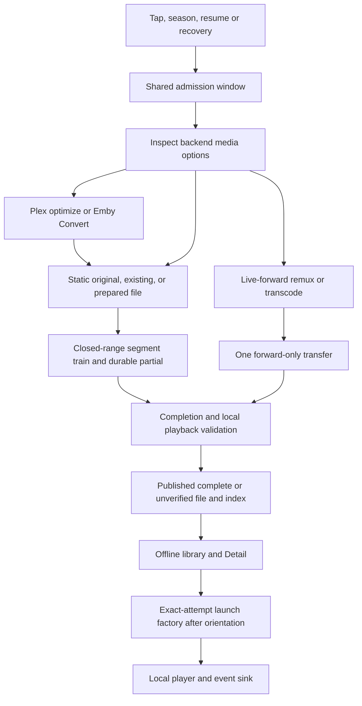
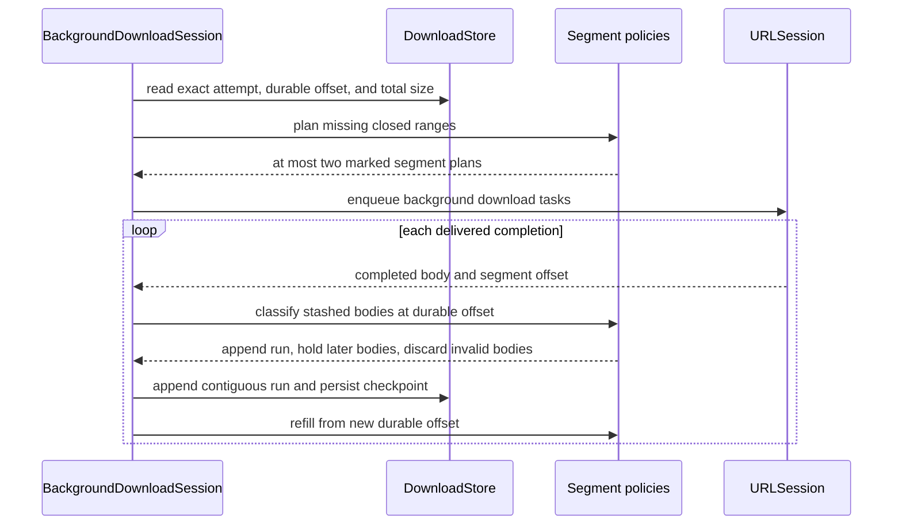

# Downloads and offline playback

Labstream downloads are implemented for the visionOS, iOS/iPadOS, and macOS targets and are designed
to end in a local file the current device can play, plus enough metadata to show the item in the
offline library and resume safely. The same engine is present in the [macOS target](MACOS.md), where
background recovery remains a pre-release acceptance gate rather than a reliability promise. The
[tvOS target](TVOS.md) compiles no Downloads capability or Offline surface.



The admission window is shared by user actions and recovery. Server preparation hands a completed
render to the static lane; live-forward streams cannot claim static byte resume. Finalization
captures an attempt-owned body, rewrites HEVC tags and validates before publication. Probe-inconclusive
and repeated-truncation files remain playable as unverified. Detail and Offline use the same local
launch factory, with position saving and actual-playing verification as separate events.

## Core rules

- A completed download must have a local playable file and a durable offline record.
- Direct original downloads are offered only when Labstream expects the file to play locally.
- Server-rendered or server-prepared routes are used when the original is not a safe local target.
- Transfers reconcile on relaunch. Static/original and server-prepared static routes
  resume from durable checkpoints when their persisted authority remains valid; live-forward
  remux/transcode streams may become retryable and restart from the beginning
  rather than claiming unsafe byte-offset resume.
- Offline records must never contain access tokens. They do persist the minimum backend
  context needed to resume and clean up a job, which currently includes the owning backend,
  server base URL/server ID, MediaBrowser user ID where applicable, media/play-session IDs,
  and route/checkpoint state. See [Persistence](PERSISTENCE.md#app-container) for the complete
  on-disk and credential boundary. Treat `index.json` as private app data, not a shareable profile.

## Backend routes

| Backend | Download choices |
| --- | --- |
| Plex | Compatible original, explicit existing version, and completed optimizer output all hand off to a static file transfer. |
| Jellyfin | Original is static/range-resumable. Compatible remux and capped transcode are live forward-only streams. |
| Emby | Original, reusable existing version, and completed Convert output are static. Compatible remux is live forward-only; a requested transcode is normally rerouted through persistent Convert-then-static. |

## Transfer lifecycle

Each download row persists a **lifecycle** and an **attempt history**. Every change to them goes
through one pure reducer, `DownloadLifecycleReducer`. The serialized `DownloadStatus` that the
UI, diagnostics and older app versions read is derived from the lifecycle.

```mermaid
stateDiagram-v2
  accTitle: Download lifecycle
  accDescr: A row is planned or admitted, may prepare on the server, transfers bytes, and enters finalizing once a complete body exists. Finalizing ends complete or unverified after publication, or failed. Interruptions pause a row with a recorded cause; errors fail it with a recorded reason. Retry modes choose where a paused or failed row resumes.
  state "planned" as Planned
  state "admitted" as Admitted
  state "serverPrep" as ServerPrep
  state "transferring" as Transferring
  state "finalizing" as Finalizing
  state "paused" as Paused
  state "failed" as Failed
  state "complete" as Complete
  state "unverified" as Unverified
  [*] --> Planned
  [*] --> Admitted
  Planned --> Admitted: admission granted
  Admitted --> ServerPrep: Emby Convert
  Admitted --> Admitted: Plex optimize preparation
  ServerPrep --> Admitted: prepared source handed off
  Admitted --> Transferring: transfer starts
  Transferring --> Finalizing: complete body at the working path
  Finalizing --> Complete: validated and published
  Finalizing --> Unverified: published; probe inconclusive or repeated truncation
  Finalizing --> Failed: validation fails
  Transferring --> Paused: interruption (cause recorded)
  Transferring --> Failed: transfer fails (reason recorded)
  Paused --> Admitted: resume or retry
  Paused --> Transferring: resume blob
  Paused --> ServerPrep: prep reattach or Convert resume
  Failed --> Admitted: retry
  Unverified --> Complete: eligible actual playing or revalidation
  Complete --> [*]
  Unverified --> [*]
```



This diagram shows lifecycle destinations; admission and retry routing still depend on durable
facts. Plex preparation retains admitted/queued compatibility, while Emby Convert uses serverPrep.
Finalizing is not paused by cancelling its validator. Only eligible actual-playing evidence or
successful revalidation can clear an unverified warning; playing the start of a known truncated file
cannot prove its tail exists.

| Lifecycle | Serialized status |
| --- | --- |
| `planned`, `admitted` | `queued` (a `planned` row is waiting for an admission lane) |
| `serverPrep` | `preparing` for Emby Convert; Plex optimizer rows stay `admitted`/`queued` until the handoff |
| `transferring`, `finalizing` | `downloading` |
| `complete`, `unverified`, `paused`, `failed` | the same name |

**Attempt history** records what no status can:
- truncation strikes;
- the reason a row is `unverified`;
- the last failure;
- why a row paused (user, queue paused, system interruption, awaiting a session, storage,
  deferred resume).

Rules that follow from this:

- **Progress never promotes a paused, failed or finalizing row.** It only records the bytes
  (B09).
- **`finalizing` is persisted** as soon as a complete body reaches the attempt working path. A
  relaunch before validation re-finalizes that body instead of deleting it (B10). A forward-only
  body exists at the working path only once its whole transfer finished, so the same rule covers
  a finished forward-only body whose task was lost.
- **A finished forward-only body is captured before anything else.** A forward-only stream
  cannot be fetched again by range, so its finished body is the whole download.
  - The URLSession delegate moves a media response (2xx, not an HTML, JSON or XML page) from the
    OS temp to the attempt's capture path in the downloads directory and records
    `bodyCaptured`, which makes the row `finalizing` at once. The row references that path while
    it is not terminal, so the staging sweep leaves it, Delete removes it and the storage audit
    counts it.
  - The queued publication then renames it onto the working path and validation runs. After a
    relaunch reconcile reports the body as captured, keeps or makes the row `finalizing`
    (whether or not `bodyCaptured` was durable yet), and launch recovery requeues the
    publication.
  - A rejected response is not a download. It keeps an in-memory `tmp/` stash until the
    publication fails the row with the server's reason.
- **A pause never discards a finished body, on either lane.**
  - Forward-only: the publication runs behind a pause halt (only a cancel, a Delete or a stale
    attempt stops it) and the row finalizes; a paused row found at relaunch with its whole body
    captured or at the working path finalizes too. Pausing a `finalizing` row does nothing.
    The pause had parked the row's optional side assets, and a finished row has no Resume, so
    the publishing finalizer unparks them (unless Pause All holds the row; Resume All then does).
  - Static range: a finished segment is appended and the row then pauses. The pause's task
    listing leaves a task that has already finished tracked, so its finish callback still
    writes the body; it supersedes and cancels only tasks that are still transferring.
- **Reconcile asks the session what it owns when it decides.** Its live keys are a snapshot
  reattach took earlier. For an active row (never a paused one) reconcile also counts work the
  session owns at that moment: a finished body queued for its append, a delayed retry, a request
  rebuild or a finalizer. Such a row is not failed with zero durable bytes. One ordering is not
  covered: a finished task the daemon has not redelivered at all when reconcile runs (#476).
- **Truncation strikes persist** with the row and survive a relaunch.
  - A Retry of the same server, account, item, source and profile inherits them, and a replayed
    validation outcome is not counted twice.
  - The second strike keeps the body as `unverified` and publishes it.
  - Revalidating a published body never fails or deletes it for truncation (B54).
- **Relaunch reconciliation** applies the reducer to each row's facts: route, durable checkpoint,
  body, pending artifact intents, deletion state and live task. Any file deletion it decides runs
  outside the store lock. A live task never promotes a paused row, whatever paused it: every
  pause cancels its task and reattach never adopts a paused row's task, so a paused row in the
  live-task snapshot is a stale entry for a task being torn down, and the row stays paused (F2,
  #473).

Finalization still rewrites HEVC `hev1` to `hvc1` before validation, and both terminal success
states keep the local file. The opaque and static-range pipelines share the completion path.

### Truncation and checkpoint authority

A failing truncation verdict permanently condemns that attempt's working body. A best-effort rename
removes it from the working path before persistence waits; the persisted condemnation fence also
blocks checkpoint reads, recovery finalization and Retry cloning if rename/removal fails. Replacing
an attempt inherits only same-source truncation strikes, never condemnation or unrelated failure
state. A condemned Retry starts at zero even if its backend becomes available later. Replayed body
outcomes do not count another strike. A second-strike published body remains unverified and playable
across relaunch; neither position updates nor actual playing erase that warning.

### Bounded background completion

OS completion handlers are timestamped at registry receipt, including before session construction.
One non-sliding wake budget covers finish-events, identified operations and the captured index plus
artifact boundary: 25 seconds overall, 20 seconds for operations and a 5-second persistence reserve.
Normal release requires finish-events, settled required operations and persistence covering their
resulting boundary. Expiry is an explicit timeout, not successful durability or physical cancellation.
Exact handler tokens release once; an old timer or operation end cannot release a later generation.

Blocked-before-transport, activation-in-progress and failed-after-transport remain distinct. A
blocked dormant session can release a late handler; an existing healthy transport retains its owned
holds. Expiry also fences later activation, refill and probing until foreground or a new authorized
wake. Dirty index work, artifact intents and worker-owned path leases survive a waiter's timeout.
No AVPlayer validation probe starts while inactive; foreground revalidation remains recoverable.
These are app-side bounds, not proof of OS scheduling or background continuation on hardware.

## Background downloads and sleeping devices

The Downloads header reports aggregate speed only when every transferring attempt has fresh
delegate observations over one common interval within the last four seconds. It shows
**Updating speed…** while that evidence is incomplete; queued, preparing and finalizing rows do
not count as transfers. Foreground, a background-session wake, or a gap of six seconds in an
attempt's callbacks discards the old batch window. Each attempt's first callback establishes a
new watermark, with four seconds of baseline replacement to exclude buffered catch-up bytes
(#224), before the shared window can produce a total. Staggered callbacks are interpolated
inside their observed overlap, never extrapolated or silently omitted. Observed quiet intervals
contribute zero; a silent attempt makes the total unavailable once the common window expires,
until it has been silent for the six-second callback gap in a process that kept observing (no
callback since its last one, or since the last reset if it has not reported since). From then it
counts as zero, so one stuck transfer cannot hide a healthy batch's speed (#487), and its next
callback resets the batch like any other late watermark. A batch in which every attempt is silent
has no total. The refresh loop keeps running while any row is transferring (every second while a
total shows, every 15 s otherwise), so a row that stalls silently loses its speed and ETA at the
next refresh past its six-second stall timeout (#488).
A dip in a Range attempt's reported bytes resets its window only when bodies that finished but are
not yet appended cannot explain the whole dip, so the total survives 512 MiB segment boundaries
(#416; `DownloadLiveRangeProgressPolicy`). All measurement state is memory-only.

For the shared pre-overhaul transport crawl reported in #409, static closed ranges have a
bounded foreground experiment. After authoritative reconciliation and ten seconds of settling,
one 60-second continuously active counter window can select a known `background_wake` task
below 128 KiB/s with more than ten minutes remaining at that rate. Zero progress uses the same
window. A task with at most 256 MiB of nondurable body may be plain-cancelled and reissued on the
same session; a fresh counter must still meet the cap immediately before cancellation. Exactly
256 MiB is allowed. One exact attempt gets at most one recovery per process, with one operation
in flight globally. The 30-second result observations overlap subsequent rows' recoveries, so
both rows in the two-row/two-task crawl can reissue around seconds 70–80 after reconciliation.
Unknown relaunch provenance is observed and diagnosed without reissue. Eligibility starts at the
baseline boundary: connectivity restored during settling does not invalidate the subsequent
window; an interruption inside measurement produces a deferred result.

The selected task alone loses its nondurable body. The attempt, durable checkpoint, held tail,
healthy sibling, resource validator, train epoch and 512 MiB/depth-two sizing survive. Checkpoint
failure leaves the original task running. Inactivity or P6 winding-down at the real persistence-to-
resume edge parks the replacement with an exact-attempt refill intent. Renewed foreground
reconciliation runs the gap planner even beside a live sibling, without spending another recovery.
Temporary refill or resume failures also retry within the same activation, at one-second intervals
for at most three retries, then hand off to ordinary request recovery. These retries preserve the
sibling and spend no additional health-recovery budget. Finished bodies remain planner coverage
throughout the delegate-to-assembly handoff, including before they become held; an invalidated
train's pending bodies retain cleanup ownership but cannot cover replacement requests. Expired
physical workers retain their leases and defer recovery. No health state or revocation history is
persisted, so a kill loses provenance and the experimental budget; normal reattachment may adopt
the old task.

Diagnostics extend `downloads.range_start` with creation context, session kind and registration
phase, and distinguish actual `downloads.range_resume`. One `downloads.range_health_reissue`
candidate event is paired with `downloads.range_health_result` after about 30 active seconds
or at the actual pause, cancel, error, completion or inactive edge. Results use that stop's elapsed
interval and outcome, and repeat provenance, exact pre/post counters and rates,
old/new task IDs and discarded bytes. `downloads.range_health_foreground` records aggregate
activity edges. Terminal-attempt budgets and obsolete connectivity entries are retired; pauses
retain the one-shot budget. There are no periodic healthy verdicts. Persistent OS scheduling
treatment is a hypothesis; paired device evidence and hardware acceptance remain pending.

Downloading while the app is backgrounded, suspended, or the device is locked/asleep is
fundamentally constrained by the platform, not by the server or the app:

- **Only system-owned transfers keep running.** True background `URLSessionDownloadTask`s owned
  by the system daemon (`nsurlsessiond`) may continue; app-side work (server-prep polling,
  keepalives, timers) is frozen while the app is suspended.
- **Background transfers are deprioritized.** The OS gives interactive networking and power
  management priority over background bulk transfers, so throughput can be substantially slower
  than the same download with the app active.
- **Background app wake-ups are rate-limited.** Each time the system relaunches the app for a
  background-session event, it may delay the next opportunity to do app work. Any design that
  needs an app wake-up per bounded transfer therefore stalls after a handful of handoffs
  regardless of transfer size.
- **Background scheduling remains system-controlled.** Labstream asks for non-discretionary
  transfers, but the OS still decides when background work runs and how much network/power budget
  it receives.

Labstream's static byte-range lane is shaped around these limits and follows the simplest
Apple-standard architecture we can make stable:



- **A pre-queued train of closed-range segment tasks for known-size static files.** The
  same segment-train engine runs on visionOS, iOS/iPadOS, and macOS; Mac background recovery
  remains a platform-specific release-acceptance gate.
  Static Plex/Jellyfin/Emby file routes enqueue up to `maxQueuedSegments` (currently 2) background
  `URLSessionDownloadTask`s ahead of the durable checkpoint, each a closed
  `Range: bytes=<offset>-<offset+segmentBytes-1>` request of `segmentBytes` (512 MiB) —
  roughly 1 GiB of queued runway per file. The two-task cap is intentional: one head plus
  one look-ahead preserves overlap without multiplying several visible downloads into
  dozens of concurrent transfers. `StaticRangeSegmentQueuePolicy` is the pure
  planner: given the durable offset, the expected total size, and the segment offsets
  already live in the session, it emits the closed ranges still needed, up to the queue
  depth. When the expected total size is unknown, the planner falls back to a single
  open-ended `Range: bytes=<durableOffset>-` plan — the same shape used before segmentation,
  so that fallback is a zero-regression path rather than a special case.
  `StaticRangeTransferConfiguration` owns only the segment size and queue-depth constants;
  transfer shape remains planner-owned so the unknown-total open-ended fallback follows the
  same attempt and durable-checkpoint rules as the closed train.
- **Segments are attempt-marked and stashed, then assembled in order.** Each new segment
  task's `taskDescription` combines the rating key and current
  `lbs-segment:v3:<offset>:<attemptID>` marker with a U+001F separator. Relaunch/reattach
  therefore requires both the row and exact attempt, not merely a reused rating key.
  Old V1/V2 segment markers, V1 opaque markers, bare descriptions, and URL-derived identity are
  no longer parsed or adopted. `StaticRangeReattachPolicy` accepts only a current,
  offset-matching task for the row's exact attempt; every unmarked, malformed, stale-attempt, or
  mismatched task is cancelled.
  When a segment task
  finishes, its body is stashed by offset; `StaticRangeSegmentAssemblyPolicy` — a pure
  assembler — decides, given the durable offset and the set of stashed finished bodies,
  which stashes form the maximal contiguous run starting exactly at the durable offset
  (appended now), which are held (a later segment finished out of order, waiting on a gap),
  and which are discarded (fully behind the checkpoint, or overlapping but not
  offset-aligned — the same non-negotiable append-alignment invariant as the pre-segment
  design). Appending a run advances the durable checkpoint and refills the train back up
  to the queue depth.
- **URLSession resume data remains first-class only for the single open-ended fallback.**
  The store has one resume-blob slot per download row. When an unknown-size static source uses
  `Range: bytes=<durableOffset>-`, pausing can preserve that task's OS temp progress and display
  watermark in a blob. Adoption requires the blob's original open-ended Range offset to equal the
  current durable partial. The resumed task may count from its own baseline or cumulatively, so the
  live display latches that choice on the task's first callback (`displayBytesForResumedTask`) and
  shows `max(count + rebase, watermark)`; judged per sample, a fresh count crossing the watermark
  made the bytes fall and the aggregate speed reset (#502).
- **Closed train segments never persist or adopt URLSession resume data, including the head.**
  CFNetwork can replay a resumed closed request past its original end, so pausing a segment train
  clears any old blob/watermark and plain-cancels unfinished segments. The app-owned durable partial
  remains authoritative. Completed held bodies are durably manifested and may be rehydrated across
  relaunch only when their exact attempt, length, and validator checks still match; mismatches fail
  closed and re-fetch. Unfinished ranges are planned again on Resume.
- **The durable partial is the fallback.** A rejected old-format closed-range blob, or an open-ended blob that is
  missing, malformed, stale, exhausted, or backed by a deleted temp file, is rejected and cleared
  together with its display watermark. Recovery then re-plans from the durable partial's current
  file size rather than appending unvalidated bytes.
- **Free-space admission follows the physical append timeline.** Start, continuation, blob Resume,
  and automatic storage-full parking charge the remaining network bytes, the largest upcoming
  append copy, uncached side-asset estimate, and headroom. Durable checkpoints and held bodies
  already on disk are counted once.
  A blob refused for space keeps its resume authority and display watermark; it reports storage
  exhaustion without treating the blob as corrupt or restarting the transfer.
- **Transient Range retries are bounded by durable progress.** Optimistic URLSession progress does
  not reset the retry budget. Positive appends, including held-body drains, reset it; explicit user
  start/Resume resets it too. Transport drops get four retries with delays of 1, 2, 4, and 8 seconds. Delayed retries hold the background completion
  gate through successor registration and check attempt, train epoch, and restart generation.
  Pause/Resume invalidates old timers while preserving already finished bodies.
- **Stash sweeps respect in-process ownership.** Both temporary and durable held bodies are claimed
  before their rename and remain protected through queued append or manifest publication until
  consumption/discard. The final claim check and orphan deletion share one lock boundary.
- **HTTP safety checks still guard the append.** Completed bodies are validated for
  `Content-Range` start alignment, pinned validator mismatches, HTTP `200` full-body
  replacement/restart behavior, `416` total validation, temp disappearance fallback, and safe
  resume-blob adoption/clearing. A strangely resumed transfer is rejected, restarted, or
  falls back to the durable partial rather than appending unvalidated bytes.
- **Why segments, not one task:** a visionOS wake bounce can silently restart the body of an
  in-flight custom-`Range` request with no error and no resume-data callback (see the
  [verified platform finding](DEVELOPMENT.md#verified-platform-findings)). With one open-ended task, that restart forfeits
  every un-appended byte transferred off-head, unbounded overnight. With a segment train,
  nsurlsessiond executes pre-queued segments with the process dead — no per-continuation app
  wake is required — and a wake-time bounce can only restart the one segment that was mid-flight
  (at most `segmentBytes`). Markers allow surviving tasks and delivered completions to be
  mapped back to their row and offset after reattach, but do not assume the OS will always
  redeliver a completion that occurred while the process was dead. Only bodies actually
  recovered through the background-session lifecycle are adopted; otherwise the durable
  partial remains authoritative and the missing range is re-planned and re-fetched.

Simulator caveat: Labstream intentionally uses a foreground/default `URLSession`
in simulator builds because the background transfer daemon is unreliable there.
Simulator passes can validate routing, progress UI, and retry policy, but not
real background continuation, lock/off-head scheduling, or cellular policy.

User-facing expectations worth setting (the "downloads disclaimer"):

- Very large background downloads are best-effort. Keeping the device on power helps; briefly
  foregrounding the app gives Labstream a chance to process delivered completions or recover
  app-owned work, without guaranteeing any change to the OS scheduler.
- Plex optimize and Emby Convert are server-side preparation jobs. Their app-side polling and
  handoff cannot run while the app is suspended; Emby Convert job identity is persisted so polling
  can resume after relaunch. Once either route hands off to a static file, the byte transfer can use
  the static recovery path.
- Fresh and resumed Plex optimize jobs inspect metadata before creating work. They reuse an
  existing render only when it is a server-optimized part (under
  Plex's "Plex Versions" path) that matches the requested tier: resolution as a bounding box
  within ±16 px and container bitrate within ×1.10 of the video cap plus 768 kbps, and
  original-quality requests must land at the source height. `OptimizedVersionMatch` owns this
  rule, so a 1080p/8 Mbps retry never silently reuses an older 720p render.
- Plex queue inspection distinguishes a present item, proven absence, and unavailable inspection.
  Only proven absence plus a successful metadata inspection can create a job. Immediately before
  dispatch, the row durably records a 3-minute visibility grace. Relaunch preserves that timestamp:
  absence during the grace keeps inspecting without another create; proven absence after it fails
  server preparation if no matching version is visible. An HTTP 400 duplicate rechecks adoption;
  other create errors fail promptly. The separate 120-second completion/indexing grace and
  authentication failure budget remain in force. The 24-hour prep deadline applies only while
  nothing is rendered: a matching finished render (for example one that waited for a transfer
  slot across a relaunch) is adopted even past it (#414). Static handoff uses the live
  server lane on which the rendered Part was observed.
- Fresh Plex and Emby preparation starts return after registering their poller tasks. Delete
  cancels those tasks. Emby reuse and completed conversions share one handoff that detaches its
  own poller before releasing prep bookkeeping, then starts the existing-version static lane.
  Pause All parks Emby Convert through the same cancellation path as a row Pause.
- Jellyfin optimized/compatible-remux downloads, and Emby compatible-remux
  downloads, can be live-forward encoder streams. They may continue as
  system-owned transfers while the OS allows it, but they are not durable
  byte-range checkpoints and can require retry/restart after interruption.
- Cellular downloads are off by default where cellular data is available.
  Settings ▸ Downloads ▸ **Use cellular data for downloads** also governs
  constrained networks (Low Data Mode) and expensive networks such as a personal
  hotspot: while it is off, downloads wait for an unconstrained, inexpensive
  network. It applies to newly created request-based transfer tasks and side-asset
  fetches; active tasks and tasks resumed from OS resume data keep the policy
  they were created with.

## Module ownership

| Component | Owns |
| --- | --- |
| `DownloadManager` | Main-actor queue coordination and user-visible state. |
| `DownloadKeepaliveCoordinator` | Exact-attempt Jellyfin/Emby keepalive task ownership and credential-generation quarantine. A keepalive runs only while the session tracks a live transfer for that attempt. Emby sends Ping only; Jellyfin currently sends Playing/Progress at a fixed position of 0 instead of the transfer's byte fraction. This is an interim containment: it stops downloads from reporting advancing positions, but it is not proven to leave watch state untouched. The live Ping-only A/B decides the final shape, and the watch-state check stays open until it does. |
| Backend-specific manager extensions | Plex/Jellyfin/Emby route setup and server-prep polling. |
| `BackgroundDownloadSession` | URLSession tasks, segment-train enqueue/refill, transfer callbacks, finalization, and wake-release effects. |
| `BackgroundDownloadWakeCoordinator` and wake budget contract | Exact-token completion gate, receipt-based absolute deadline, identified operations, deferred revalidation and rebuild grace generations. |
| `DownloadManager+SeasonPlanner` and `SeasonDownloadPlannerSheet` | Immutable season drafts, one atomic Store commit of planned rows plus retry intents, and the refreshed, source-validated first start. |
| `DownloadAdmissionCoordinator` and `DownloadManager+Admission` | The one admission window: observed lane occupancy, supervised starts, durable waiting requests, backoff and the Pause All row exemption. |
| `DownloadOptionsModel` | Typed per-item option resolution for the download sheet; it does not own season planning. |
| `DownloadVolumeFreeSpace` | Purgeable-inclusive free-space measurement used by storage-full parking. |
| `DownloadStore`, async contract and path leases | Schema-v5 index state, exact-attempt work/mutation admission, bounded submit/resolve, off-lock filesystem observations and physical path exclusion. |
| `DownloadArtifactLifecycleCoordinator` and file-effect seams | Order attempt-scoped resume/checkpoint/promotion/deletion work with its terminal persistence outcome. |
| `DownloadWorkRegistry` | Attempt-scoped side-cache and encoder-task ownership. |
| `DownloadCleanupIntentJournal` | Independent durable, credential-free server-cleanup authority for all three backends: Jellyfin/Emby encoders, Emby Convert jobs and Plex optimize queue items. |
| `DownloadCleanupIntentRunner` | The only executor of journaled cleanup: eligibility, ownership recheck, bounded concurrency and per-intent backoff with its own wake-up. |
| `EmbyConvertCleanupJournal` | Legacy Emby Convert tombstones, read only to migrate them into the cleanup journal at launch. |
| PMSKit download policies | Pure route, retry, row-display, and recovery decisions, including the segment-train planner and assembler. |

## Server cleanup

Every server resource a download stops needing is recorded in the cleanup journal before
anything cancels it. That covers a Jellyfin/Emby encoder (`activeEncoding`), an Emby Convert
job (`knownJob`, or `ambiguousCreate` when the create response was lost) and a Plex optimize
queue item (`plexOptimize`). The journal lives in an authority directory outside the versioned
media root. Each write uses the index's commit protocol: temp file, full fsync, rename and
directory sync. A write whose final sync fails is reported as a failure, never proven by
re-reading the file. The directory and every file are excluded from backup and data-protected.

Each intent records why it exists:

| Provenance | Written by | Runs when |
| --- | --- | --- |
| Row deletion | Delete, before the row is removed | the row's removal has committed |
| Terminal release | Launch/backend-switch sweep for a terminal row's handles | the row is terminal and not protecting the job for Retry, or the row is gone |
| Abandonment | Superseded negotiations, stale creates, duplicate jobs, the 24-hour Convert expiry, abandoned Plex seeds, stale optimize-job sweeps | whenever the ownership recheck passes |

The runner executes nothing while a row's deletion is staged, in flight, or failed. Just before
each server call it re-checks ownership: another row's PlaySessionId, Convert job, queue title,
or a job that row's crash-window recovery would adopt keeps the resource. Convert cleanup and
Convert crash-window recovery are serialized per server. Claims are scoped to persisted server
and MediaBrowser user, never the currently visible browse lane. After each awaited inspection,
claims and eligibility are reread immediately before cancellation. An originating Convert/Plex
attempt still claims a resource while its persisted reference remains; a failed abandonment write
cannot take its job. For a nonresumable encoder, the origin claims only while its transfer is active,
allowing interrupted release to replay safely.

The runner coalesces producer/recovery/session triggers, executes at most two intents at once and
schedules its own earliest retry. Per-intent backoff ranges from 30 seconds to 30 minutes, with
a two-minute local eligibility recheck for waiting work. Legacy import/quarantine barriers run
before every pass; unreadable authority is never an empty queue.

Plex queue responses are classified explicitly:

- a completed render is kept (deleting the queue item would delete the version);
- a malformed list, a duplicate title or an unknown state keeps the intent;
- an absent item retires the intent only once the create PUT is known to have landed.

An unresolved create is retried, slowly after a day, and retired with a diagnostic after a week.
One race is accepted: a render that completes between the queue read and the DELETE is
deleted, because PMS has no conditional cancel. The delete confirmation therefore says
in-progress preparation is cancelled "where possible".

Abandonment producers submit journal I/O to a worker and await a bounded durability result.
A stale Plex title sweep commits its discoveries in one transaction. A failed or expired
observation does not authorize a superseded-encoder stop or an Emby stale-create cancel;
late durable intents remain replayable by the cleanup runner. Producers recheck captured
server identity and exact row authority after suspension before dependent handoffs.
Sign-out pauses rows rather than deleting them. Active encoders still need a journaled release
captured before credential revocation; see [Local playback and row presentation](#local-playback-and-row-presentation).

## Offline metadata

Offline records keep enough information to display and play the item without a live server:

- backend and item identity;
- title/metadata needed for the offline library;
- local file URL and byte counts;
- selected media characteristics;
- optional poster and side-asset references;
- resume/progress state where applicable.

Paths in the JSON index are one-level paths relative to the Downloads directory and are
re-hydrated against the current sandbox at load time. Absolute container paths are not
stable across installs. URLSession resume data is stored as a protected, backup-excluded
sibling artifact and referenced by relative path; it is only valid for static/range-resumable
sources. The storage and backup boundary is detailed in [Persistence](PERSISTENCE.md#app-container).

Side assets such as posters, chapters, and compatible external text subtitles are cached next to the download record when available. They are treated as convenience metadata; the main playable file remains the durable core of the download.

Posters are offered as soon as an owned row is queued, including season plans and restored
active rows when their matching backend session becomes available. This poster-only pass runs
independently of media admission and server preparation; BIF, trickplay, chapters and subtitles
keep their normal later scheduling. It uses the existing paced, authenticated side-asset transport
and respects network preferences. A pause stops transfers, not a row's own artwork: paused rows
and rows waiting behind Pause All are offered a poster too, and the poster fetch has its own
side-asset owner that Pause and Pause All never park (every other side asset stays parked with
the attempt; Delete cancels both). Like every other side asset, a poster fetch registers its
owner when it starts, so a cancel that kept the row and attempt (for example a Plex preparation
poller that found no session) does not stop later poster fetches for that attempt (#482). Each attempt/source gets one early offer per
launch; a failed fetch is non-fatal and remains eligible for normal later side-asset hydration.
Validation, attempt/source-fenced staging and promotion, `sideAssetBundleOwner`, and
`posterGeneration` are unchanged. Cached poster bytes count as side-asset storage, survive
relaunch, and feed the shared Offline row artwork on visionOS, iOS/iPadOS and macOS. Rows
without artwork retain the placeholder glyph; tvOS has no Downloads capability.

## Local playback and row presentation

Detail's Play Offline and the Offline library admit the exact rendered attempt after orientation.
One manager-owned factory rechecks ownership, deletion, terminal state and the local file, then
captures local resume/rewind, metadata-owned backend/assets and an attempt/session-bound event
sink. The shared player consumes that sink: actual playing can verify eligible unverified rows,
while repeated-truncation warnings remain. Position updates coalesce behind bounded asynchronous
P6 persistence, including a terminal close sample; no synchronous close flush or rating-key save
adapter remains. Positions are local only: watched/progress sync-back and offline Up Next remain
separate work.

Sign-out parks rows immediately and captures exact encoder-cleanup authority before credentials
are revoked. Encoder-release journal work uses a P6 worker submission and bounded asynchronous
resolution. Only a durable journal result permits compare-clearing that exact play-session handle;
failure or expiry retains its row/transient authority, and an old completion cannot erase a newer
handle. Recovery must replay retained exact releases after journal failure or timeout.

Offline offers embedded subtitles and downloaded text sidecars together with one Off choice.
Opening the menu does not parse sidecars. Selecting embedded, sidecar or Off revokes the other
selection; item/session/selection generations reject late parses. Emby converted downloads retain
an independent original text-subtitle source. Historically ambiguous origins skip repair safely
and keep existing cached subtitles and playable media.

Library and current-download sheets share lifecycle-driven rows. On visionOS and macOS,
waiting/paused and route/context are neutral, verified completion green, caution orange, and
failures/destructive controls red. All text lines share a leading edge without status icons;
poster badges remain. Finished rows show
one tail-truncated summary: `Downloaded • 1080p • 5.7 Mbps avg • 1.6 GB + 12 MB extras` or
`Not verified • 1080p • 6.1 Mbps avg • 1.8 GB`. Resolution, local media average bitrate and size
are omitted when unknown; extras appear only when present. Finished rows have no separate quality
line. Other states retain requested quality, progress and captions. Context and status stay
single-line with full accessibility values; VoiceOver adds “Downloaded and verified” or
“Downloaded; playback not verified” to the full summary. Error details expand.
On iPhone/iPad (`DownloadRowContent.mobileBody`) a row is a one-line title, one context line
(the backend only when backends are mixed, the metadata or requested quality, and the size once
finished) and a 1–2 word status from `compactStatusText` (Ready, Unverified, Downloading 42%,
Queued, Paused, Preparing, Verifying, Failed). Caution uses the secondary color plus a warning
triangle, never orange, because amber means selection on iOS. The full caption is the status's
accessibility value. Offline is one list in every width with no detail page: a tap plays a
finished row or opens an unfinished row's actions, and long-press and swipe offer the same.
Server indexing, preparation and verification remain distinct, and preterminal progress never
claims 100%. Delete captures exact attempt identities and explains supported unfinished server-job
cancellation while retaining finished server versions.

Availability is a generation-tagged off-MainActor scan, refreshed at publication, foreground and
recovery boundaries. Body/progress reads do not stat files. Readable blocked recovery permits
terminal playback with mutations disabled; opaque unsupported/unreadable indices cannot open
Offline. Restricted Offline consumes Cinema returns and acknowledges their identity before
Reconnect, preventing normal Root from replaying an old return.

## Reconcile and resume

On launch, Labstream compares the offline index, files on disk, active transfers, persisted
artifact reservations, and durable cleanup intents. Current reconciliation:

Startup first installs all transfer callbacks and registers the still-dormant session with the
background-completion registry. When the Store admits a healthy current index, the initial
transport submission crosses one bounded MainActor turn and retains the manager until that
submission occurs. A retry before that turn cancels the deferred edge and owns the one immediate
submission, so retry cannot overtake it or submit activation twice.

A readable load that finishes after the startup deadline still publishes rows and Offline
availability, even if its background wake has expired. Transport, probes and queue refill stay
dormant until foreground or a new background wake authorizes recovery; older load generations
cannot overwrite a newer recovery attempt.

- **Unsupported schemas** keep their explicit reset path.
- **Unreadable indexes and malformed current ownership** remain fail-closed.
- **A v4 index** runs the one-time upgrade pass (see PERSISTENCE) before `.ready` is published.

**Delete** stops exactly its attempt: tracked tasks, any OS task carrying that attempt's marker,
prep pollers and keepalive. It never stops a replacement attempt.

A row being deleted, whether behind a row-deletion barrier or as a capsule, admits no new work:
- transfer start, resume and finalization;
- retry continuation;
- season admission;
- Plex optimize polling and creation.

Recovery also:

- adopts only current task markers whose exact attempt matches the durable row;
- keeps current malformed/ownerless active rows fail-closed rather than guessing ownership;
- resumes/retries recoverable transfers and surfaces terminal failures in the row. A row whose
  last failure was storage-full is not automatically redriven: every automatic static-range
  redrive (rebuilds, backend-ready drains, launch recovery) first re-measures free space —
  counting iOS purgeable space, matching the Settings storage gauge — and, if the volume still
  cannot hold the remaining network bytes, largest append copy, uncached side assets and headroom,
  parks the row as a pending resume instead of retrying. A user-initiated Retry can reattempt immediately, but still passes admission and storage preflights;
- migrates legacy Emby tombstones and pre-upgrade quarantined Plex intents into the cleanup
  journal, then runs required server cleanup through the cleanup runner (see
  [Server cleanup](#server-cleanup));
- inventories and repairs missing posters, subtitles, chapters, Plex/Emby BIF, and Jellyfin
  trick-play playlists/tiles for completed rows without re-downloading playable media. The Plex
  BIF and subtitles come from the part the row downloaded, not the media's first part. The repair
  resolves that part in the refreshed item by the persisted `sourcePartID`, so a later reorder of
  the item's media cannot hand it another version's assets; an ID the item no longer has selects
  nothing, and only rows that stored no ID fall back to `mediaIndex`/`partIndex` (#503). A
  successful source refresh also saves chapter thumbnails the row was saved without and fetches
  them, so later inventories owe them; the poster selector skips an empty or blank artwork field
  and uses the next valid one (#504). Work runs
  off-main, validates image/BIF/text payloads before promotion, and batches metadata publication.
  Retry authority is exact attempt + source + resource kind and is charged only when an eligible
  waiter actually admits transport; coalesced cancellation or a stale waiter hands authority to the
  next eligible waiter. The worker inventories every owned side asset even after finding a missing file, so playlist
  repair retains later existing tiles when their server requests would fail. Successful promotion,
  including a same-path replacement, advances the side-asset generation so byte accounting and
  storage-cap snapshots cannot retain stale cache values. The repair needs the row's own backend
  session, so launch also restores the saved session of a backend that is not selected when one
  of its completed rows misses a side asset (#494);
- keeps completed media available without requiring the source server to be reachable;
- keeps a failed Emby Convert row's server job when Retry would resume it: the launch and
  backend-switch cleanup sweep cancels Convert jobs only for completed, deleted or abandoned rows,
  using the same predicate as the retry gate. Forward-only encoders of failed rows are still
  stopped, because they cannot resume;
- parks a static row at its durable checkpoint when the system (not the user) cancels its
  background task, and fails a forward-only row as retryable in the same case;
- puts a forward-only row back in the admission queue when it has no task, no body and no
  checkpoint: a granted start that the process lost before its task existed waits for a lane
  again, as it would in process, and a row paused before it ever started stays paused (it used
  to come back as a network failure; Admission-A1, #475). Foreground reconcile skips
  forward-only rows a granted start may still own, since admission is open then;
- fails a Jellyfin download or retry with "version no longer available" when the requested
  MediaSource has disappeared, instead of silently fetching another edition;
- treats sign-out of a backend as a resumable pause of that backend's active rows. Records
  and files stay; `DownloadManager.pauseDownloadsForBackendSignOut` runs while credentials
  still exist so encoder teardown can use the right session. This is not cancel or delete.

If the selected saved session cannot be restored because its server or network is temporarily
unreachable, launch finishes in a restricted Offline surface when at least one completed media
file is still present. This surface exposes only the local library/player plus reconnect,
sign-in, Settings, resume-position, and deletion controls; it does not fabricate an authenticated
browse session. Missing or explicitly invalid credentials continue to show sign-in instead, and
tvOS never enters this path because it does not ship downloads.

Admission is decided from a typed selected-session restore outcome that Plex, Jellyfin, and Emby
all report through `AuthManager.sessionRestoreOutcome` (PMSKit `SessionRestoreOutcome`):

| Outcome | Produced by | Saved credential | Launch surface |
| --- | --- | --- | --- |
| `restored` | live lane published | kept | browse |
| `missingCredential` | no saved credential, or explicit sign-out | absent | sign-in |
| `invalidCredential` | HTTP 401 (Emby: probe reports another user); a Plex 401 on inactive download hydration also classifies here but keeps the token | retired | sign-in |
| `unconfirmedCredential` | HTTP 403, or Jellyfin 2xx probe for a different user | kept | sign-in/retry |
| `temporarilyUnavailable` | transport, DNS, TLS, timeout, Plex discovery, HTTP 429/5xx or any other non-401/403 status (a reverse proxy can answer 404 while its upstream is down), or an unreadable reply such as a captive portal | kept | Offline if a completed local file exists, otherwise sign-in/retry |

`OfflineLaunchAvailability.admitsOfflineLaunch` is the pure gate. Reconnect re-runs the selected
restore in place; a successful restore flips `isBrowseReady` and `BrowseUIGate` mounts the normal
root.

Season confirmation captures one immutable draft containing new rows and exact retry attempts. The
Store validates every owner and commits insertions plus retry admission intents in one
snapshot before any lane starts; stale ownership, a normal persistence failure, and an indeterminate
atomic-write outcome remain distinct, with the last case pausing download admission. Offline list
snapshots contain scalar presentation/action identity only; full records resolve at exact-attempt
action or playback edges. Storage presentation separates known, unknown, and not-applicable bytes
instead of turning unknown side assets or reservations into false zeroes.

Every download start goes through one admission window (`DownloadAdmissionPolicy`, driven by
`DownloadAdmissionCoordinator`): single taps, season rows, Resume All, a row's Resume or Retry,
automatic static range resumes and stalled-stream restarts. (A Jellyfin or Emby forward-only
stream with no byte progress for 90 s is restarted from byte 0 at most twice between forward
bytes; the next stall fails the row as stalled with a retryable reason and no admission request,
so the user retries it, with a fresh restart budget (#497). A queued stall verdict acts only if
the row is still the same attempt and its bytes have not moved since the stall was seen.)
Settings ▸ Downloads ▸
**Simultaneous downloads** sets the total cap from 1 to 5 (default 3). The static-file lane is
`max(1, total - 1)` and live-forward streams are capped at 1. Server preparation (Plex optimize or
Emby Convert) is not a transfer and does not count toward the total (#414): up to 5 server jobs
are submitted at once whatever the setting, so a queued batch renders on the server while the app
is suspended, and the server's own transcoder settings decide how many render concurrently. The
pure policy takes limits supplied by the manager-owned coordinator,
which reads the persisted preference at every gate, including relaunch recovery. Explicit row
actions are served before automatic ones; the origin orders requests and never lifts a cap.

Lowering the setting never cancels running transfers: existing work is grandfathered, and no
new row enters until total and lane occupancy are below their limits. Raising it wakes an
admission pass so waiting rows start as soon as the applicable lanes have room. The setting is
available on visionOS, iOS/iPadOS and macOS; tvOS has no Downloads settings.

- **Occupancy is observed.** A row uses its lane while its persisted lifecycle is `admitted`,
  `serverPrep` or `transferring`, it is not being deleted, and live work backs it (a start slot,
  a registered prep poller or a session-owned transfer). Pause, failure, finalizing and delete
  free the lane without any release call.
- **Finished renders wait for a transfer slot (#414).** When a Plex render or an Emby Convert job
  with a persisted job identity finishes, the row keeps its prep slot and reads **Ready — waiting
  for a download slot…** (iPhone/iPad: **Queued**) until the static and total caps have room, then starts its byte transfer
  with the live backend session. Waiting renders go first come, first served, and ahead of new
  transfer starts (taps, Resume, Retry, automatic static resumes); new server jobs can still be
  submitted meanwhile. The wait is in memory: after a relaunch the resume poller finds the
  finished render and waits again. An Emby start that reuses an already converted version has no
  job identity yet, so it hands off at once; that handoff and grandfathered relaunch work can
  briefly put static occupancy over its cap, and nothing new enters the static lane meanwhile.
- **Starts are supervised.** A granted start is fenced by a generation until its async work
  finishes. A start that ends without work (no session, a refresh outage) waits again with
  backoff of 1, 5, 15, 30 and then 60 seconds instead of failing; a definitive refusal (signed
  out, source gone, storage) stays a visible failure. Pause and delete end the supervision, so a
  granted continuation never starts a paused or deleted row.
- **Waiting is durable.** A season episode, or a tap that finds every lane full, waits as a
  `planned` row carrying its exact source binding, route, preset and audio choice, and starts
  through the refreshed, source-validated first-start path. Resume All and a capacity-delayed row
  Resume or Retry keep the row paused or failed with a `retryRequested` intent, so its retry
  routes from its own facts (checkpoint, resume blob, Emby job, Plex queue item). Waiting rows read
  **Waiting for a download slot…**, or **Waiting — downloads paused** during Pause All
  (iPhone/iPad rows show the compact **Queued** or **Paused**).
- **Bulk controls** show **Pause All** whenever any row is active, preparing, retrying or
  waiting for admission, including paused/failed rows with a pending retry request. Mixed idle,
  completed or failed rows never hide Pause All. With no running or requested work, paused/failed
  rows or a paused queue offer **Resume All**. A row waiting behind Pause All (for example a
  download added while the queue is paused) is held, not running: it does not bring Pause All
  back, its own action is Resume, and Resume All starts it. The label and icon follow each
  published snapshot; the control is disabled until startup recovery is ready.
- **Pause All** closes the admission gate, withdraws waiting retry requests and pauses active
  rows, including Emby Convert preparation via the same cancellation path as a row Pause.
  This cancels local preparation pollers; remote conversion jobs retain their existing resumable
  ownership, with supported remote-job cleanup belonging to Delete.
  Finished bodies already being verified are allowed to finish. A row's own Resume or Retry
  during Pause All is exempt for that row only; its pending or active work offers Pause All
  again, and the next Pause All revokes every exemption. Side-asset work that enters a fetch
  behind Pause All is parked even for a row the pause did not stop (a completed row's next
  subtitle stream or trickplay tiles), so **Resume All** unparks the side assets of every row
  that is not itself paused before it runs the completed-row repair (#483).
- **Barriers.** Nothing is granted before startup recovery has reattached tasks and pollers (work
  the OS still owned counts first, even over a cap), or while a season commit is proving
  durability.
- **Lane changes.** A start that turns into server-prep work (a Plex original that failed its
  preflight, an Emby negotiation rerouted to Convert) needs room in that lane first; otherwise it
  ends without work and waits.

Emby itself processes Convert jobs from its *Convert Media* scheduled task, which Emby staff have
described as one conversion at a time. A second Labstream Convert can therefore wait as
server-side `Queued` even outside Labstream's own lane cap. Static downloads need no conversion
and are not tied to that server queue.

Storage uses one rule for every gate (`DownloadStorageAdmissionPolicy`, P5):

- **Storage limit.** Every row counts once: the bytes it holds plus its cached side assets.
  Admitted, preparing and transferring rows also reserve their known remaining bytes. A retry or
  re-download replaces its own row's contribution instead of adding to it. The same rule checks
  the download sheet, every backend start, the season commit (including retried episodes) and the
  Plex fallback before it asks the server to render.
- **Unknown sizes stay unknown.** Known side assets never turn an unknown media size into an
  "extras-only" number. The download sheet says the size is unknown and that the download is not
  counted toward the limit; the season sheet asks for confirmation. Jellyfin and Emby items now
  carry their source size, so originals are rarely unknown.
- **Cap limitation.** Starts that pass checks concurrently before publishing their sizes are not
  protected by a new atomic reservation transaction. Admission caps bound concurrency, but the
  limit can temporarily overshoot; later checks and reactive ENOSPC remain backstops.
- **Free space** follows the file's physical timeline. The transfer still needs the network bytes
  not yet on disk, plus the largest body it will append (that copy briefly exists twice), plus
  the duration/chapter-based side-asset estimate less bytes already cached (floored at zero),
  plus 500 MB of headroom. Only usable, nonoverlapping held bodies beyond the checkpoint reduce
  future network bytes; consumed bodies receive no further credit. The measurement counts
  purgeable space, as the Settings gauge
  does, and an ENOSPC during a transfer still fails the row with the storage-full affordance.

A planned row with no in-flight slot is waiting, not transferring. All current-download surfaces
use the shared waiting caption; an admitted row may show **Queued…** and a server-prep row
**Preparing on server…** (the compact iPhone/iPad forms are **Queued** and **Preparing**).
**Downloading optimized** is the static transfer of an existing or converted version. When it reads
0% with a spinner, the row is active but URLSession has delivered no body bytes yet. Common reasons
are the window before the first byte, OS scheduling, and the per-host connection limit, since each
static row can queue two segment tasks.

## Formal model (TLA+)

`specs/downloads/` holds TLA+ models of the downloads manager, checked with TLC: one module for
the session core and one for each subsystem around it, each in its own folder, with the modules
they share in `base/`. `specs/README.md` covers the layout and config naming. The session core covers transfer, finalize
and sweep. It explores every interleaving of the user, the URLSession daemon, delegate callbacks,
the finalizer, the stash sweep, relaunch and foreground recovery, and process death, for one or
two rows and two attempt IDs.

What the session core checks:

- a complete row always has its published body;
- a finalizing row has the body it finalizes, except the residue of F4 until reconcile fails it
  (`FinalizingHasBody`; the unconditional form, `FinalizingAlwaysHasBody`, fails today);
- a truncation verdict that took a body off the working path is on the row
  (`VerdictSurvivesCrash`; fails today, F4);
- a stash whose append or publication is queued is never swept (B03);
- the manager's side of a transfer-error handoff acts only for the attempt that raised it (B12);
- a finished body survives a crash at any step (B10; `FinishedBodyNotLost`, fixed as F1);
- a finished body survives a user pause on either lane, counted from the moment the last static
  segment has finished (`FinishedBodySurvivesPause`; fixed as F3);
- a user-paused row is not restarted except by the user (B02, B09);
- a replayed finalize outcome is a no-op;
- under stated fairness, an admitted row eventually reaches a terminal lifecycle, a user pause or
  deletion.

The models were audited by an independent reviewer and strengthened in a second round. A check
that the first round reported as passing and that turned out to prove less than it said is named
as such below and in the plan's "Round 2: independent review" section.

### Modules

| Module | Holds |
| --- | --- |
| `base/DownloadsBase.tla` | The shared vocabulary (lifecycles, pause causes, routes, body and task states) and the rules for writing a module. |
| `base/DownloadsReducer.tla` | `DownloadLifecycleReducer.reduce` as pure operators: `Reduce(state, event, facts)` returns `Applied(state, effects)`, `Illegal` or `Replayed`. |
| `base/DownloadsReducerTable.tla` | Generated. The Swift reducer's results over the whole finite fact space and a fixed set of states. |
| `base/DownloadsReducerConformance.tla` | Compares `Reduce` with that table. |
| `session/DownloadsSessionCore.tla` | The session, finalize and sweep model. It changes lifecycle and history only through `Reduce`. |
| `session/DownloadsSessionRowMap.tla`, `session/DownloadsSessionRowMapCheck.tla` | How the session model stores a reducer state in five fields, and the check that this mapping commutes with the reducer. |
| `admission/DownloadsAdmission.tla` | The admission window: lanes, waiting rows, the pump, Pause All. |
| `server-prep/DownloadsServerPrep.tla` | Server preparation: the Plex optimize and Emby Convert runners. |
| `cleanup/DownloadsCleanup.tla` | Delete, the server-cleanup journal and a full volume. |
| `wake/DownloadsWake.tla`, `wake/DownloadsWakeLaunchGate.tla` | Background wakes, completion handlers, startup admission; the launch recovery gate. |
| `side-assets/DownloadsSideAssets.tla` | Posters, chapter images, trick-play and subtitles. |
| `storage/DownloadsStorage.tla` | Byte accounting, the storage cap, preflights and storage-full parking. |
| `range-train/DownloadsRangeTrain.tla` | The static-range segment train with held bodies. |
| `status/DownloadsStatus.tla`, `status/DownloadsStatusPhase.tla` | What the Downloads screen says: speed, bytes, phase and caption; the phase rule as a function and a 288-row table. |

Each module names the Swift files it models on `\* MODELS:` lines under its `MODULE` line. A new
subsystem gets its own folder and `Downloads<Name>.tla`; the comment block at the top of
`base/DownloadsBase.tla` is the contract for naming, imports, configs and findings. Each
module folder, `base/` and `session/` included, has a notes file (`specs/downloads/<folder>/README.md`) with its model-to-Swift
table, bounds, properties, per-config results and full finding traces.

### Subsystem models

Every subsystem module keeps a whole reducer state per row and changes lifecycle only through
`Reduce`, except the two wake modules, which have no rows. Finding IDs carry the module name;
[Open findings](#open-findings) has the issue for each.

#### Admission (`DownloadsAdmission.tla`)

Two lanes under the simultaneous-downloads total, waiting rows (planned, or parked with a
requested retry), the pump, supervised starts, Pause All, Resume All, backoff, process death, a
cap the user changes while work runs, the Emby reuse handoff and a pause whose cancel lands
later. Occupancy within the cap is not an invariant of the app: the setting can be lowered while
work runs, a reused Emby source hands off with no slot, and a pause's cancel lands after its
tracking is dropped. The checked guarantee is `GrantRespectsObservedOccupancy`: every new grant
leaves the total and its lane within the current cap, counting every observed occupant.
`OccupancyBoundedByHistory` and `DaemonTasksBounded` bound what can be over. The plain cap
invariants are checked only in configs with a fixed cap and no reuse. It also checks that a
queued row always has a supervised start behind it, that a user pause withdraws a waiting retry
and keeps a first-start intent, that an outage defers a first start, and, under fairness, that
no waiting row waits forever. Fix-off configs reproduce B63, B65, B66 and B67; B65 off is the
historical Resume bypass alone (`FirstStartGoesThroughWindow`), and erasing the first-start
intent on pause is a mutant. Admission-A1 is fixed: recovery never fails a forward-only row
without start evidence (`RelaunchKeepsUnstartedRow`), and `Faithful-A1-off` restores the old
failure. Not covered: the server-preparation lane,
lane switches, the render handoff (#414), the admission persistence proof, new rows and Delete.

#### Server preparation (`DownloadsServerPrep.tla`)

One row on either runner: create or adopt, poll, hand-off, reattach after relaunch, Pause, Resume,
Retry, Delete, the cleanup runner's cancel, stale poller chains, lost requests and responses, the
24-hour Plex render deadline and the hand-off's wait for a static slot. It checks that no job is
created while a matching render exists (B35), that the hand-off happens at most once and only
for an active row, that a create proven missing fails the row before the render deadline (B37:
the historical code ended the wait a day late, so `Faithful-B37-off` is a safety run), and that
Delete cancels unfinished preparation durably (B28, B47). The liveness result `PrepSettles`
rests on the static lane draining (`Mutant-SlotNeverReturns`). Findings ServerPrep-S1 (Plex
only; Emby passes the same properties) and ServerPrep-S2. Not covered: more than one row, the
preparation-lane cap, signed-out sessions.

#### Cleanup and Delete (`DownloadsCleanup.tla`)

Delete from the tap to the last reclaimed byte: the deletion-pending capsule, the row-deletion
barrier and artifact queue, the artifact worker, legacy promotion recovery, the cleanup journal
and runner, failed unlinks, a failed directory sync, and a volume that can be completely full.
Process death and power loss are separate steps; power loss also drops unsynced journal bytes.
It checks that no file is left without a row, that a server job is always accounted for by a row
or a journal entry (B18), and that a job is kept while a row needs it (B28, B44). It confirms
the open B27 and B30 and found Cleanup-C1.

The deletion recipe is unlinked in the order Swift sorts it. The working body's name
(`.attempt-stage-v1-<digest>.stage`) sorts before every stable name the app generates, so a
Delete that is allowed over a legacy promotion flag unlinks the working body first and the
launch recovery has nothing to rename. The fence between Delete and that recovery, which the
first round called a requirement of the B27 fix, is defence in depth for generated names; the
orphan-file trace needs a stable name whose first character sorts below `.`
(`Mutant-B27-PreemptWithoutFence`). The proposed full-volume reserve is counted in writes: a
Delete of a row with a server job makes four (reservation, journal entry, deletion intent,
terminal snapshot), and a Delete tapped again must reuse a durable intent, because today the
retry waits for a fresh snapshot and each failed unlink or directory sync would use one more
unit (`Mutant-B30-ReserveTooSmall`, `Mutant-B30-RetapNeedsFreshWrite`). C1 and B30 should be
fixed together. Not covered: retry by replacement, paths shared across rows, abandonment
intents.

#### Wake (`DownloadsWake.tla`, `DownloadsWakeLaunchGate.tla`)

The completion registry, the wake coordinator with its budget timers, and startup admission, with
OS handler delivery, finish-events, a clock and process death. The clock keeps running while a
timer callback waits; a callback is at most `TimerSlack` ticks late. It checks that every stored
completion handler is claimed within its budget plus that slack (`HandlerClaimedWithinBudget`,
which no longer accepts another timer being due as an excuse) and is eventually called, that the
gate holds for a delayed retry's successor (B04), that a startup block releases a handler
without dropping live holds (B05, B06, B11), and that an operation's hold is bounded by the
operation deadline alone (B13, `OperationHoldBounded`). The absolute-deadline and registry
timers have their own mutants. The second module models the launch recovery gate (B77).
Findings Wake-W1 and Wake-W2, both probable and both in app-target code, so neither has a PMSKit
pin. Not covered: timer arming (timers are derived from state), rebuild grace, per-task callback
admission (B07).

#### Side assets (`DownloadsSideAssets.tla`)

The poster, chapter images, Plex and Emby BIF, Jellyfin trickplay (a playlist and a tile task
group) and text subtitles, across the work registry, the fetch coordinator's park, unpark and
cancel commands, the per-launch retry budget, the completed-row repair scan, Delete, replacement
attempts and process death.

Its main property, `NeverForgotten`, says that while the server answers, the queue is not paused
and the row's own server and user has a saved session, every asset the server holds for a
complete or unverified row ends cached. It is checked with launches that keep coming and each
start with an empty retry budget, so an exhausted budget, a parked or cancelled coordinator
owner or a dropped repair pass cannot satisfy it: only durable state can bring an asset back.
`MissingIsDurablyOwed` states the same as an invariant. `CachedThisLaunch` is the stronger
reading: cached without a relaunch, given recurring foreground edges. The first round's version
of this property counted a spent in-memory budget as an account of the asset and passed with
all discovery switched off; that result is withdrawn.

The completed-row scan is modelled as it is in the code: one inventory pass per edge, dropped
while another runs, on its 30 s timeout, or for a row whose generation moved. Sessions are per
backend and mean the row's own server and user; launch hydrates the selected backend,
backends with active work, and backends with a completed row that misses an asset. Delete is the store's staged deletion against its three-step
promotion. Properties are scoped to rows with an attempt ID; a completed row without one is a
malformed index that the store resets on load (`Mutant-UnownedRow`). The model also checks that
repair stays inside the coordinator's cap and budget (B25), that commands apply in request
order (B32), and that a user-paused row's parked payloads stay off the network.

Findings SideAssets-S1 to S8; the model also reproduces the deferred st-39 and #394 (for
trickplay tiles too). `NeverForgotten` holds on the code as it stands for every kind with every
environment switch on, including the triggers of S3 and S5, so each of those lasts one launch; it
failed for S7 until the #495 fix. S1, S2, S6 and S7 are fixed in the code (each keeps a
`Faithful-*-off` config that fails with its fix switched off). The round 2 re-review added asset identity and source drift
(`Drift`): `CachedAssetIsForDownloadedPart` says no cached file belongs to another part (#503),
and `ServedAssetInInventory` says an asset the server holds is in the inventory derived from the
saved row or a refresh adds it (#504); both are fixed, with `Faithful-503-off-*` and
`Faithful-504-off-*` configs. Not covered: request pacing, coalesced waiters, a
source-identity change inside one attempt, a recorded file that disappears from disk, a task
cancelled mid-promotion, an offline launch.

#### Storage (`DownloadsStorage.tla`)

What each row holds on disk, the storage cap with reservations, the free-space preflights,
storage-full failure, the automatic-redrive gate and the storage audit, with bytes as small
integers. Launch is two steps, as in the code: candidates are captured, then the task
enumeration reconciles and redrives only candidates that are not live. A body redelivered before
the enumeration is adopted with no request and continues through a request rebuild. It checks
that a preflight refusal is justified (B01), that a retry is counted once and the cap honoured
(B24), that a full disk is classified as storage (B26), that a parked failure says storage
(B31: `Faithful-B31-off` persists a failure without the reason and violates
`ParkedFailureSaysStorage`; it no longer claims a blind redrive), that a storage-parked row is
not redriven without measuring, that the audit counts hidden staging (B19; the audit's
enumeration is listed apart from ownership, `Mutant-AuditSkipsHeld`), and that startup leaves no
orphan (B86). The #401 limits are stated as passing properties: a paused row keeps its bytes,
and orphans are reclaimed only at startup. Finding Storage-S1. Not covered: a held body stashed
but not yet in its manifest when the process died.

#### Range train (`DownloadsRangeTrain.tla`)

Parallel segment tasks up to the shipping depth of two, out-of-order bodies held through their
three stages (stash, durable held file, manifest), the one-append-per-pass drain, purge, pause
and resume, Retry, one changed-resource restart, restore after relaunch, both orphan sweeps,
reconcile and the stale-row self-heal. Offsets are in bytes (`SegBytes`); a crash can leave any
prefix of a body in the working file, so recovery from a checkpoint inside the live train's
grid and the planner's interval-aware gap filling are exercised (`Current-MidAppend`,
`Mutant-OffsetEqualityPlan`). It checks that a held body is never swept between its rename and
its manifest (B22), that recovery never discards the attempt's working checkpoint (B00), that a
queued body is not swept (B03), that every segment body is appended at its own offset, and that
a stale train's body changes nothing, that a pause keeps a segment that has already finished
(R3) and that reconcile never fails a row whose work the session owns (R2). `Faithful-B00-off` switches off what 852e9f7f fixed, the
manager's retry policy and stale-row detector, in two configs: Resume deletes a resumable
partial, and a stranded train never self-heals. Store reconcile was never part of B00. Findings
RangeTrain-R1 to R4 (R3 fixed; R2 fixed except a body the daemon has not redelivered). Not covered: validators, the HTTP 200 and 416 paths, retry budgets, blob
resume, path leases, and `SegBytes = 2` with three segments (more than ten million states; it
did not finish).

#### Status and speed (`DownloadsStatus.tla`, `DownloadsStatusPhase.tla`)

The aggregate speed, each row's speed, bytes, phase and caption, across sleep and wake, pause and
resume, silent stalls, the forward-only stall restart cap, and process death. Time is abstract:
an estimator is the stage it has reached, how old its last callback is, and whether the batch's
windows share the 0.5 s that `rate(at:)` needs. The model has no numeric speed; values are the
Swift tests' side. Bytes exist three times: the index file, the store's live row (a
forward-only progress sample reaches the file only with a persistence ticket) and the last
published snapshot. It checks that a published batch speed leaves no transfer out of the sum,
warming up or quiet (#379), and is measured over an interval every transfer shares; that no
speed divides bytes that piled up during a sleep by a short interval (#224), under the stated
timing assumption that a backlog is fully reported inside the 4 s windows; that a segment
boundary never resets the batch (#416); that phase, sidebar and health snapshot say active work
only when work exists; that "Waiting for <backend>" is said only of a row with no session and
no task; that a row waiting for admission reads as waiting (pu-33); and that shown bytes never
go down while a row stays downloading in a live process, and that a task resumed from a blob
publishes bytes that never fall and never pass the true total (#502). The phase rule is a function with a
288-row table in `DownloadsStatusPhase.tla`; TLC checks the table against the function and
`DownloadsFormalModelStatusTests` checks `DownloadRowStatusCaptionPolicy.phase` against the
table. Findings Status-S1 to S8 and #502; S1, S2, S5, S8 and #502 are fixed. The Swift suite adds seeded property tests and worked examples
of the estimators' arithmetic. The callback-gap reset has no TLC mutant: every sleep in the
model is reset at foreground first, so that rule is exercised only by the seeded Swift test.

#### What the liveness runs assume

A liveness pass is a statement under fairness, and the fairness is an assumption about the
world. The session and range-train runs assume three things the code cannot promise by itself:
the session's own steps run; a retried transfer eventually finishes (the code has retry budgets
instead, which the models do not count); and the manager's main-actor recovery runs, which a
suspended background app does not get. `range-train/Mutant-NoForegroundRefresh` drops the last
one and the stranded train then never moves. In the session model `StallDetected` exists only on
the forward-only lane in the code; on the static lane it stands in for stale-row recovery, which
the range-train model has. The durable side-asset property assumes only that launches keep
coming; the this-launch one assumes recurring foreground edges. Server preparation assumes the
static lane drains. Each liveness config's header says what it assumes.

### Running it

```sh
scripts/check-tla-specs.sh                                             # every module, default tier
scripts/check-tla-specs.sh specs/downloads/admission                   # one module folder
scripts/check-tla-specs.sh specs/downloads/session/Current-Static.cfg  # one config
scripts/check-tla-specs.sh --deep                                      # also the deep configs
scripts/check-tla-drift.py                                             # modelled Swift changed without its spec?
```

The script downloads a pinned `tla2tools.jar` into the gitignored `build/tla/`, verifies its
SHA-256, parses every module and runs TLC on every `.cfg`, with `base/` on the TLA+ library path
so a module folder can import the shared modules. Each config's log is kept at
`build/tla/downloads/<folder>/<config>/tlc.log`. It needs a JDK (Homebrew `openjdk`, or
`JAVA=`); without one it exits 2 and says so. On a 14-core Mac the default tier (238
configs) takes about fifteen minutes and the nine deep configs about twenty-seven more. Run
one instance per worktree at a time. A run counts only when TLC's exit status, its banner and a
clean finish agree, so a crash after an expected violation banner is a failure. Each config
states what it expects in its header:

| Config | Meaning | Must |
| --- | --- | --- |
| `Current-*`, `Liveness-*` | The code as it stands. | pass |
| `Faithful-*` | One shipped fix turned off. Shows the model can see that bug. | be violated |
| `Mutant-*` | A deliberately injected bug, for a subsystem with no historical one, or a mutation that once slipped past a check, kept so the check's strength stays tested. | be violated |
| `Finding-*` | An open defect the model found on the current design. | be violated until fixed |
| `Proposed-*` | Proposed fixes turned on. Some are marked not enough and are paired with a `Finding-*` that shows the gap. | pass |
| `Reducer-Conformance`, `Projection-*`, `SessionRowMapCheck-*` | The reducer checks below. | pass, except their mutants |
| `Deep-*` (`\* TIER: deep`) | Larger bounds. Skipped unless `--deep`, `--deep-only` or `TLC_TIER` asks. | pass |

A config sits in its module's folder and is named for its kind: `admission/Current-Mixed.cfg`,
`cleanup/Faithful-B18-off.cfg`. A helper module's configs keep its name in front
(`wake/WakeLaunchGate-Current-Gate.cfg`). TLC does not name a violated liveness property, so such
a config declares `EXPECT: violation TEMPORAL` and names the property in its comment line. A
config that lists several properties must name the failing one
(`EXPECT: violation TEMPORAL <Property>`); the runner then checks that property alone and the
others without it. `specs/README.md` has the details.

### Keeping the model equal to the code

Three mechanical checks stand between the Swift and the specs:

1. **Reducer table.** The PMSKit test `DownloadsFormalModelReducerTests` runs the real reducer and
   compares the result with the checked-in `DownloadsReducerTable.tla`. The table covers the
   whole finite fact space (1,280 records: every route, checkpoint, body and live-task value
   crossed with the three guards that make relaunch a no-op) and 1,728 states (every lifecycle
   with every single and every pair of history-field values). It stores 217,728 event results
   and 80,640 relaunch results (1.4 MB). Two lemmas, checked in Swift and in TLC, make that the
   whole reducer: relaunch reads only lifecycle and pause cause, and no other event reads the
   facts. The suite takes about half a minute. A reducer change makes that test fail until the
   table is regenerated:

    ```sh
    LABSTREAM_WRITE_REDUCER_TABLE=1 swift test --package-path PMSKit --no-parallel \
      --filter DownloadsFormalModelReducerTests
    ```

2. **Reducer conformance.** `base/Reducer-Conformance.cfg` fails unless `Reduce` in
   `DownloadsReducer.tla` returns exactly that table, and unless the table covers every lifecycle,
   event, route, checkpoint and body. So a regenerated table cannot land without the matching
   spec change, and a spec change cannot land alone. A failing run prints the disagreeing
   `<<state, event>>` and `<<state, facts>>` indices; they are the numbered lines of the table.
   Three `Mutant-*` configs in `base/` are wrong readings of the relaunch guards that the first
   round's sampled table passed (a deletion guard honoured on the static route only, for one).
   `session/Projection-SessionCore.cfg` proves that the history fields the session model leaves out
   never influence the ones it keeps; it compares the reducer with itself and checks field names
   only. `session/SessionRowMapCheck-Current-RowMap.cfg` checks the operators the session model
   actually runs (`SessionRow`, `SessionStored`): mapping a state down and back commutes with the
   reducer for every table state, used event and fact record.
3. **Drift guard.** `scripts/check-tla-drift.py` (default range `origin/main...HEAD`) fails when a
   file on a `MODELS:` line changed and nothing in its module's folder did (in `base/`: the
   module or one of its configs). A change that does not affect the
   model says so in the commit that makes it:

    ```text
    Spec-Unaffected: comment-only change to the session
    ```

    Every commit that touches the modelled file needs the trailer, unless the module or one of
    its configs changes in the same range. That includes a merge commit whose recorded result
    differs from Git's own merge of its parents (a conflict resolution, or an edit made while
    merging); a clean merge needs nothing. The guard reads the `MODELS:` lines and the modelled
    files from the range's head commit, never from the checkout, and counts a config the range
    deleted or moved for the module it ran. It also fails when a `MODELS:` line names a file
    that no longer exists. `specs/README.md` has the cases.

Only the reducer, the session's row mapping and the status phase rule are covered mechanically.
Everything else is a hand-written abstraction of the Swift; the drift guard makes a change there
visible, and a person decides whether the model follows. Several modules now list the large
files they model (`DownloadManager.swift`, `BackgroundDownloadSession.swift`,
`DownloadStore.swift`) on their `MODELS:` lines, so most downloads changes need a spec edit or a
`Spec-Unaffected:` trailer.

CI: `.woodpecker/tla.yml` runs the default tier and the drift guard on the macOS runner (manual,
`main` only, like `macos.yml`), and `.woodpecker/tla-drift.yml` runs the drift guard on pull
requests, against the pull request's own target branch
(`origin/$CI_COMMIT_TARGET_BRANCH...HEAD`). The step stops if that variable is unset or malformed
and never falls back to `main`. Neither pipeline has run on a live Woodpecker server yet. The reducer table test runs with the rest of PMSKit in `.woodpecker/pmskit.yml`.

### Open findings

Each finding was checked against the Swift before it was recorded. A real finding with a pure
decision to test is pinned by a `withKnownIssue` test in
`PMSKit/Tests/PMSKitTests/DownloadsFormalModel<Name>Tests.swift` (the session core's are in
`DownloadsFormalModelFindingsTests.swift`), so the suite stays green and the test fails as soon
as the defect is fixed. A fixed finding stays in the table until its fix is merged: its pin is
then a plain regression test and its `Finding-*` config a `Faithful-*-off` one.

| Finding | What goes wrong | Verdict | Issue |
| --- | --- | --- | --- |
| F1 | A crash between the `tmp/` stash and the working path loses a finished forward-only body. | fixed on `specs/downloads-tla`, pending merge (`session/Faithful-F1-off`) | #472 |
| F2 | Foreground reconcile moves a user-paused row back to transferring from a stale live-task snapshot. | real; fixed on specs/downloads-tla, pending merge | #473 |
| F3, RangeTrain-R3 | A user pause that lands while a transfer finishes discards the finished body. Forward-only: real. Static range (the pause's task listing supersedes a finished segment; one segment on a train, the whole remainder on the open-ended fallback): probable. | fixed on `specs/downloads-tla`, pending merge (`session/Faithful-F3-off`, `-Static`, `range-train/Faithful-R3-off`). The static fix rests on the same unexecuted step as the finding: that `getAllTasks` lists a finished task whose callback is queued. | #474 |
| F4 | A failing truncation verdict renames the body away before the verdict is durable; a crash in between leaves a finalizing row with no body, which reconcile fails as an internal error, and the strike is lost. | real, low | #491 |
| Admission-A1 | Startup recovery fails a forward-only row that never started: a granted start cut by a crash, or a first start the user paused. | real; fixed on `specs/downloads-tla`, pending merge | #475 |
| ServerPrep-S1 | Retry of a failed Plex preparation row abandons its running optimize job with no durable cancel and creates a second one. | real | #478 |
| ServerPrep-S2 | The 24-hour Plex render deadline can fail a preparation row before its create is dispatched. | probable, low | #500 |
| Cleanup-C1 | After a failed intent commit, an explicit artifact recovery re-registers the row deletion and files are unlinked before the intent is durable. | real | #479 |
| B27 | A legacy validated promotion whose body is gone makes Delete a permanent no-op. The fix needs no fence against the launch recovery for names the app generates. | real, known | #392 |
| B30 | On a completely full volume the deletion intent cannot be saved, so Delete frees nothing. | real, known | #393 |
| Wake-W1 | A completion handler that arrives while a claimed batch waits for its release inherits that batch's deadline. | probable | #480 |
| Wake-W2 | An operation begun while an expired operation lingers does not hold the next wake. | probable | #481 |
| SideAssets-S1 | A cancel that keeps the attempt leaves the poster's coordinator owner cancelled for the launch. | real; fixed on specs/downloads-tla, pending merge | #482 |
| SideAssets-S2 | Pause All can park a completed row's side assets with nothing left to unpark them: subtitles, Jellyfin trickplay tiles, and any fetch that enters late in a task. Lasts one launch. | real; fixed on specs/downloads-tla, pending merge | #483 |
| SideAssets-S3 | A server outage spends the per-launch retry budget for an asset the server has. Trickplay retries are gated by the playlist's budget alone, and a park of an in-flight request also costs a dispatch. | behaviour confirmed; product decision | #484 |
| SideAssets-S4 | A refused Resume leaves a user-paused row's side assets unparked. | behaviour confirmed; product decision | #485 |
| SideAssets-S5 | A completed-row repair pass that is dropped (an edge while one runs, the 30 s timeout, a row whose generation moved) is not run again. | real, low | #493 |
| SideAssets-S6 | A completed row on a backend that is not selected gets no session at launch, so no launch repairs its side assets until the user switches backend. | real, medium; fixed on specs/downloads-tla, pending merge | #494 |
| SideAssets-S7 | The Plex BIF is selected from the media's first part, not the downloaded part: never requested when only the downloaded part has one, the wrong index cached when the first part has one. Fixed on `specs/downloads-tla`, pending merge: the initial pass and the completed-row repair select `media[mediaIndex].part[partIndex]`. | real, medium; fixed on specs/downloads-tla, pending merge | #495 |
| SideAssets-S8 | A side-asset promotion gives up on any concurrent write to its row and nothing retries. | real, low | #496 |
| SideAssets-503 | The Plex completed-row repair looks the downloaded part up by media/part index, so after Plex reorders the item's media it fetches another version's subtitle and BIF, or none, on every launch. | real; fixed on specs/downloads-tla, pending merge | #503 |
| SideAssets-504 | Assets missing from the saved row are never fetched: chapter thumbnails the server gained later, and a poster when Plex's `thumb` is `""` with a valid `art`. | real; fixed on specs/downloads-tla, pending merge | #504 |
| st-39 | A side-asset file renamed but not yet recorded is left on disk by Delete. | real, known | #401 |
| #394 | Fetched chapter-image and trickplay-tile payloads wait in memory behind one-at-a-time preparation. | real, known | #394 |
| Storage-S1 | An automatic requeue erases a storage-full park, so the row is redriven once without measuring free space. The reachable order is a redelivered body whose own append fails with ENOSPC before the launch enumeration. | real | #486 |
| RangeTrain-R1 | A drain pass run by a held-body removal completion discards its result and strands the train until the self-heal, which a suspended background app does not get. | real | #477 |
| RangeTrain-R2 | Reconcile fails a static row whose finished body is stashed and queued for append. | fixed on `specs/downloads-tla`, pending merge, for work the session owns: reconcile asks the session when it decides (`Faithful-R2-off`; the live-key snapshot alone is not enough, `Faithful-R2-off-SnapshotOnly`). Open: a body still undelivered by the daemon at that moment is lost with any ownership check (`Finding-R2-UndeliveredBodyLost`). | #476 |
| RangeTrain-R4 | After a crash in the middle of an append, a segment finished while the app was dead is held beside the ones the planner started; when the head segment fails once, two held bodies fill the depth of two and the planner never fetches the gap at the checkpoint. | probable, medium, rare | #492 |
| Status-S1 | A silently stalled transfer hides the batch speed for as long as it is silent. | real; fixed on specs/downloads-tla, pending merge | #487 |
| Status-S2 | A stalled static-range row keeps showing a stale speed and ETA. | real; fixed on specs/downloads-tla, pending merge | #488 |
| Status-S3 | After a process death a row shows fewer bytes than before: a static-range row loses its in-memory optimistic total, a forward-only row the progress samples since its last persistence ticket. | probable | #490 |
| Status-S4 | A forward-only row's first callback after the foreground grace inflates its speed. | probable; uncertain on a device | #489 |
| Status-S5 | Past its two automatic restarts a stalled forward-only stream has no verdict; it stays downloading at zero bytes and hides the batch speed. | real, medium; fixed on specs/downloads-tla, pending merge | #497 |
| Status-S6 | Fresh evidence without a common 0.5 s window hides the batch speed; a member reporting every 3.5 to 6 s makes it come and go. | real, low | #498 |
| Status-S7 | A backlog reported after the 4 s settling and grace windows is published as live speed. | probable, low | #499 |
| Status-S8 | A queued forward-only stall verdict re-read the row but not its bytes, so a stream that moved again before the queued operation ran was cancelled and restarted from byte 0. | real, low; fixed on specs/downloads-tla, pending merge | #501 |
| Status-502 | After a static-range resume from a blob, the published bytes went backwards: per-sample normalization against the watermark let a fresh count fall below a cumulative one, freezing the row and resetting the batch speed. | real, medium; fixed on specs/downloads-tla, pending merge (`status/Faithful-502-off`) | #502 |

Wake-W1, Wake-W2, SideAssets-S3, SideAssets-S4, Status-S3, Status-S4, st-39 and #394 have a
`Finding-*` config and no behavioural Swift pin: the decision is app-target code or a product
choice, with no pure PMSKit decision to call. Many of the other pins read app source as text
for the same reason; they fail when the text moves, which is weaker than a test that runs the
path.

### What it does not cover

- Outside the reducer it is a hand-written abstraction, not a proof about the Swift.
- Each module models its subsystem alone. Interactions between subsystems (admission with server
  preparation, cleanup with replacement attempts) are not composed.
- Not modelled: the persistence writer, path leases, validators, retry budgets, and the items
  each subsection lists.
- Liveness results hold under the fairness each config states (see "What the liveness runs
  assume"). They are not promises about a suspended app or a network that never recovers.
- The models were strengthened after an independent review found checks that passed for the
  wrong reason. Nothing shows that the second round found all of them.
- The bounds are small. TLC proves the properties for those bounds only.

The plan `docs/plans/2026-11-24-downloads-tla-model.md` records the properties, results, findings
and the follow-up models.
