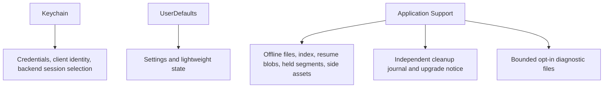

# Persistence

Labstream uses separate storage layers for secrets, preferences, and offline media.

The versioned media root and independent authority directory have different lifetimes. Deleting a
row or resetting an old media schema cannot erase its server-cleanup obligation. File effects and
revisioned index outcomes are ordered through the async store/artifact contract described below;
a timed-out waiter cannot release physical file ownership.

## Keychain

`KeychainStore` uses generic-password items with after-first-unlock accessibility. It stores:

- the Plex account token;
- the per-install `clientIdentifier`;
- selected backend and selected Plex server ID;
- Jellyfin/Emby server URL, access token, user ID, and server ID.

Not every one of those values is secret, but keeping each backend's session as one
device-local credential set avoids splitting restoration state between storage systems.

Do not write tokens to logs, diagnostics, issue templates, UserDefaults, or JSON profile indexes.

### iCloud Keychain sync

In the canonical shipping identity, exactly one item is iCloud-synchronizable: the Plex
account token. The canonical visionOS, iPhone/iPad, tvOS, and Mac variants share the
`org.labstream.Labstream` bundle ID and Keychain service string, so a Plex sign-in can reach the
user's other devices through iCloud Keychain where the platform and the user's Keychain settings
permit. Non-canonical Mac development identities intentionally disable Plex-token sync and use
isolated, backup-excluded storage; see the development exception below and the
[macOS target guide](MACOS.md).

Everything else is deliberately device-local:

- **Plex `clientIdentifier`.** It is generated once per install and never synced. Together with a
  distinct `X-Plex-Device-Name` (`Labstream/Shared/App/PlatformClientIdentity.swift`), every device
  presents its own `X-Plex-Client-Identifier`, so the server still sees independent,
  per-device-identifiable sessions even though the token is shared. Syncing it would merge all
  devices into one server-side client identity and break per-device session listings and
  transcode bookkeeping.
- **Jellyfin/Emby access tokens.** Those servers bind the token to the device ID presented at
  authentication; token and device are one server-side record. A synced token would make every
  physical device impersonate one server-side device, colliding sessions, merging played-on
  attribution, and breaking remote-control targeting. Jellyfin and Emby therefore require a
  per-device sign-in; Quick Connect and Emby Connect reduce that to a short-code step.
- **Backend/server selection.** This is a per-device preference, not a credential.

Because the Plex token is the shared item, deleting it (a manual sign-out or a 401-triggered
wipe) propagates sign-out to **all** devices, which matches how an account-level token actually
dies. When a synchronized Plex token is read successfully, any pre-sync device-local copy is
deleted; deleting the token removes both sync domains, so a stale local token cannot be promoted
after a synced or global sign-out.

Sync cannot be observed in the simulator. Unsigned simulator builds cannot reach the real
Keychain and use the DEBUG file fallback described below, so cross-device sign-in only manifests
on real devices with iCloud Keychain enabled.

The type doc comment at the top of `Labstream/Shared/Auth/KeychainStore.swift` is the source of
truth for this behavior; keep it and this section in agreement.

### Storage failures and development fallbacks

Canonical credential and selected-backend/session writes fail closed if Keychain persistence
fails. The non-secret Plex client identifier may fall back to a process-local value for one
launch so background events can still drain; a later launch retries durable storage. A
protected, backup-excluded secret-file fallback is allowed only for DEBUG simulator workflows.
Native macOS development apps with non-canonical, per-worktree keychain service identities
may opt into the same development file storage to avoid repeated prompts; the canonical
shipping service continues to use Keychain and Plex-token sync.

## UserDefaults

UserDefaults is for non-secret settings and lightweight state, such as:

- home/remote quality, adaptive bitrate, and download preferences;
- audio/subtitle language and playback-speed preferences;
- Up Next, skip, and Cinema placement preferences;
- feature toggles;
- diagnostic logging enabled/disabled and privacy-reduced MetricKit summaries;
- queue-paused and display state.

Selected backend is **not** a UserDefaults value; it is restored from the device-local
Keychain item described above.

Use token-free, hashed, or backend-scoped identifiers when preferences need to be tied to a server/session.

## App container

`Application Support/Labstream` stores:

- `Downloads/index.json`, downloaded media, durable partials, protected URLSession resume
  blobs, completed held range bodies (`*.range-held-*` files manifested as
  `heldRangeSegments`), and cached posters/subtitles/trick-play/chapter assets;
- bounded, rotated, already-redacted diagnostic JSONL files when diagnostic logging is
  enabled.

Split in-flight staging from durable held bodies. The app container's temporary directory
holds short-lived `vp-range-body-*` staging files for in-flight range responses; those
intermediates are consumed or swept and are not relaunch-authoritative. Completed
out-of-order segments are written under Downloads as `*.range-held-*` files and persisted
on the row as `heldRangeSegments`. They may be rehydrated across relaunch only when their
exact attempt, length, and validator checks still match; mismatches fail closed and
re-fetch. Do not treat held bodies as disposable temp files.

The download index is a versioned envelope at schema v5.

- **v4 still loads.** It has the same row shape, and keeps being written as v4 until the
  one-time upgrade described below stamps it.
- **Schemas 1–3 are not migrated.** Startup probes without mutating the root, drains every old
  OS task, moves the opaque root to a durable quarantine, installs a protected empty current
  root, and only then opens admission.

**The v4 → v5 upgrade** runs after transport activation and before startup reports ready. User
actions, queue work, season admission and cleanup runs are therefore still closed while it runs.

- **Kept:** complete, unverified and paused static-range rows.
- **Removed:** every other row, through the ordinary Delete. Server obligations are journaled
  first, or a capsule is reserved, and the files go through the artifact queue.
- **Rescue:** a removal candidate is spared only if a transfer completes it during the pass.
- **Stamp:** then every later snapshot is stamped v5. A crash before the stamp commits leaves the
  latest committed v4 state. Some removals may already be barriered or finished, but no row
  created after the upgrade is present, so the next launch reclassifies what remains.
- **Notice:** the Offline library shows a dismissible notice counting the removed downloads, and
  any server jobs whose cleanup identity was unavailable. Unreadable or malformed current data fails closed rather than being guessed or reset.
A schema newer than the binary (after a downgrade) is also kept and fails closed. Rows carry an
authoritative `lifecycle` and attempt `history` fields (added in v4), and the derived
`status` is still written. An older binary that drops the new fields leaves rows whose lifecycle
is re-derived from status on the next load; attempt history, including truncation strikes, reasons
and the condemnation fence, can be lost that way. Older builds carrying the newer-schema guard
preserve v5 as opaque; pre-guard downgrades do not gain that protection.
Active rows carry a typed
`DownloadAttemptID`; asynchronous tasks, artifact reservations, and cleanup compare the
full rating-key/attempt key so stale work cannot mutate a retry or re-download of the same
item. Media and side-asset paths are persisted as validated one-level paths
relative to the Downloads directory, then re-hydrated against the live container. Never
persist an absolute sandbox path; the container location can change across installs.

The index contains no access tokens, but it is not anonymous: retry and cleanup require
backend/server identity, a server base URL, MediaBrowser user ID where applicable,
media/play-session IDs, source selection, route, validators, and server-prep job metadata.
Treat it as private app data. Cached Jellyfin trick-play playlists are rewritten to local
filenames so token-bearing server URLs are not retained.

Index writes are revisioned and serialized; filesystem publication/checkpoint/resume/delete
work is registered before it starts and reaches a terminal index outcome before its
lifecycle ticket is released. Required Plex optimize, Jellyfin/Emby active-encoding or Emby Convert cleanup
also has an independent `download-cleanup-intents.json` journal containing an exact attempt,
credential-free server identity, and cleanup operation. The journal deliberately does not
share the versioned Downloads root: it lives in a protected sibling authority directory, so row
deletion or destructive schema reset cannot erase the only cleanup authority. Quarantined unsupported
roots are reclaimed on a utility queue after the new current root is durable and again on relaunch.
The compatibility `emby-convert-cleanup.json` queue has its own
`EmbyConvertCleanupJournal` persistence owner and private lock in that same authority directory;
its read-modify-write file I/O does not run while the broader `DownloadStore` index lock is held.

Persistence consumers name their contract explicitly: download/background-completion barriers,
recoverable checkpoints, best-effort buffered diagnostics, or ephemeral state. The diagnostic JSONL
sink batches on one serial queue, flushes on true aggregate inactivity, and rotates before an incoming
complete line would cross the live-file cap; it never claims checkpoint or barrier durability.

The Downloads directory, resume blobs, and development credential artifacts are excluded
from backup. PMSKit's `CredentialArtifactStorage` applies appropriate file protection on
iOS/visionOS; macOS host paths do not claim iOS file-protection semantics.

Container paths are implementation details and should not appear in user-submitted diagnostic reports.

## Download store execution and file ownership

The store keeps its lock and serialized revision writer. Production callers submit exact-attempt
work and resolve it asynchronously against one monotonic deadline. Accepted means admitted in
memory, not durable; timeout abandons only the waiter. It never cancels the physical write,
rolls back a possible commit, frees an artifact head or releases a writer's lease. After suspension,
callers compare the captured owner, action generation, source and exact server handle again before
starting work or clearing metadata. Pause and Delete install immediate admission fences before
asynchronous persistence. Startup classification, staging inventory, index decoding/loading and
repair run on a worker. The store remains admission-closed and Offline availability unresolved
until that load publishes; classification and loading reuse one decoded snapshot. Recovery journal
work also runs on workers; some off-lock lookups still perform synchronous I/O. This is not an actor
conversion or a claim of zero synchronous filesystem access.

Filesystem observations copy row authority and mutation generation, run outside the store lock,
then revalidate before mutation. Process-local path leases reserve every source and destination
atomically, including cross-kind pending-intent references. Session appends, Retry copies,
side-cache writes/publication, reconcile, condemnation and artifact execution participate. Leases
last through physical I/O and handle closure, even after a resolver deadline. A stale observation
or busy path defers cleanup conservatively. Relative names, current references and file identity
are validated again at the effect boundary; these mapped operations do not hold the store/session lock across physical I/O.

Artifact outcomes name a complete ticket epoch. Registered exact waiters retain their own failed
epoch; a later success cannot answer an earlier failure. Unclaimed retired history is capped at
512, and repeated failures do not grow live bookkeeping without bound. Unrelated index/artifact
success does not retry a permanently failed head; explicit recovery retains that authority.
Reconcile clears resume references through the durable recipe rather than unlinking behind a
live row. Generalized durable working-body reconcile recipes remain deferred.

The storage audit is report-only. It counts hidden working/staging bodies, held ranges, resume
blobs, pending publication sources, condemned bodies, index temporaries and infrastructure files,
counting each regular file once. Startup staging deletion is limited to the initialization
inventory and rechecks current references and claims. Stable media/side-asset orphan deletion is
not generalized from this audit. Duplicate current row identities block recovery and conserve the
original index bytes; the loader does not trap or silently publish a salvaged partial library.

### Additive subtitle source identity

Schema v5 optionally records `textSubtitleSourceMediaSourceID`. Missing fields decode as absent;
unknown fields can be ignored by older readers, and this does not change the envelope version.
Emby Convert/reuse/static handoff and retry preserve the original text-subtitle source separately
from the converted media/BIF output source. Repair resolves the exact source ID after reordering.
Historically ambiguous originals skip repair and retain cached sidecars and playable media rather
than substituting a sibling. Metadata merges also preserve newly cached attempt-owned assets.

### Upgrade and failure boundaries

D1 keeps complete, unverified and **every paused static-range row**, including a zero-byte partial.
The fixed upgrade candidate set can be rescued only by completion. Existing deletion barriers,
capsules and legacy pending promotion are respected; no ready state is published before the pass
finishes. The removal notice is keyed by full item/attempt identity and committed in the authority
directory with file and directory sync before the v5 stamp. Failed notice persistence leaves v4
current, retaining a fallback notice union for the next pass. Each enqueued snapshot captures its
schema version, so a delayed v4 write cannot stamp or replace later v5 authority.

Unreadable, malformed, duplicate and newer indices remain fail-closed. A readable store whose
mutation admission is blocked can still expose terminal local playback with its recovery banner;
opaque unreadable/unsupported input cannot. Retry Recovery re-probes rather than caching failure
for the process lifetime. A season transaction with indeterminate durability has its own reason
and needs exact commit proof; it is not relabeled unreadable or compensated speculatively.

Delete may queue behind a normal promotion, but preempting a wedged legacy promotion remains
unresolved. A completely full volume can prevent a durable deletion intent from being prepared;
there is no emergency bytes-first deletion protocol. Retry after space is available. A bounded
wake or a 4 MiB append buffer does not establish a global inherited-backlog memory ceiling or
bound lifetime append write amplification.

## Publication identity boundary

Current app targets use the neutral `org.labstream.Labstream` identity for the bundle, Keychain
service, diagnostics, and Spotlight domains. That neutral identity was introduced as a
fresh-install boundary from the retired private-TestFlight identity: it did not adopt credentials,
downloads, Spotlight entries, or device-local preferences from that old identity, so users
migrating from it had to sign in again. Updates that already use the neutral identity retain
their persisted state; this is not a per-release reset.

The iOS/iPadOS and visionOS background URLSession identifier intentionally keeps the shipped
`com.visionplay.downloads.background` value so in-flight transfers reattach across app updates;
do not rename it without a reattach migration. macOS instead derives
`<bundleID>.downloads.background`, so per-worktree dev identities stay isolated. A few internal
labels (the `visionplay` web-auth callback scheme, dispatch-queue labels, playback session-id
prefixes, and the SharePlay coordinator-id prefix) also retain the legacy prefix.
